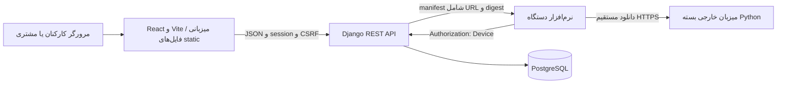

# راهنمای گام‌به‌گام Injector Server

تاریخ بررسی: **۲۰ نوامبر ۲۰۲۶ (2026-11-20)**. این سند راه‌اندازی، کار با برنامه، قرارداد دستگاه و آزمون پذیرش را بر اساس **کد موجود در working tree** توضیح می‌دهد؛ تغییرات محلی ثبت‌نشده نیز در بررسی لحاظ شده‌اند. وجود کد، بسته‌شدن تسک و موفقیت یک آزمون سه نوع شاهد متفاوت‌اند. نتایج اجرای این نوبت در بخش ۱۰ آمده‌اند و تضمین آمادگی production نیستند.

منابع تصمیم محصول: [دستورالعمل پروژه](../AGENTS.md)، [مشخصات محصول](../product-spec.md)، [مشخصات فنی](../technical-spec.md)، [طراحی](../design-spec.md) و [برنامه پیاده‌سازی](implementation-plan.md). منابع قرارداد فعلی: [بک‌اند](../backend/README.md)، [موجودی](inventory-api.md)، [دستگاه](device-api.md)، [انتشار](releases-api.md) و [مجوزها](staff-permissions.md).

> بخش «baseline» برنامه پیاده‌سازی و بخش شکاف‌های مشخصات فنی، ارزیابی تاریخی‌اند. برای مثال، کد فعلی migration، نشست مرورگر و پنل مشتری دارد. جمله قدیمی «ورود مشتری در MVP وجود ندارد» در بخش ساخت مدیرِ [راهنمای محلی](local-setup.fa.md) نیز با دامنه مصوب و کد فعلی سازگار نیست؛ بخش انتهایی همان راهنما و این سند جریان فعلی را توضیح می‌دهند. پروتوتایپ به‌تنهایی شاهد پیاده‌سازی زنده نیست.

## فهرست مسیر مطالعه

۱. معماری و نقشه مخزن · ۲. نصب و اجرای Windows · ۳. ورود و مجوزها · ۴. سناریوهای کارکنان · ۵. پنل مشتری · ۶. ارتباط و رویداد دستگاه · ۷. انتشار Python · ۸. داده و تازگی · ۹. آزمون دستی · ۱۰. بررسی‌های خودکار و نتیجه این نوبت · ۱۱. عیب‌یابی و پیش‌نیازهای عملیاتی.

## ۱. معماری و وضعیت موجود

سامانه برای ثبت مشتری و دستگاه، دریافت گزارش‌های دستگاه، نمایش وضعیت ارتباط و مدیریت metadata به‌روزرسانی Python است. سرور آزمون انژکتور را اجرا، متوقف یا کنترل نمی‌کند و خطا را تشخیص نمی‌دهد. صف آفلاین، تولید شناسه پایدار رویداد، دانلود بسته و تصمیم نصب امن مسئولیت نرم‌افزار خود دستگاه است؛ کلاینت واقعی دستگاه در این مخزن نیست.



در توسعه، Vite درخواست‌های `/api` و `/health` را به `127.0.0.1:8000` proxy می‌کند. مرورگر به PostgreSQL وصل نمی‌شود. Compose پایه دو سرویس `db` و `api` دارد؛ فرانت‌اند را جدا اجرا می‌کنید. API با Gunicorn و سه worker بالا می‌آید. پورت دیتابیس در Compose پایه به میزبان منتشر نمی‌شود. این توپولوژی محلی، طراحی نهایی میزبانی عملیاتی نیست.

| مسیر | کاربرد فعلی |
|---|---|
| [src/App.jsx](../src/App.jsx) | انتخاب کنسول زنده به‌صورت پیش‌فرض؛ داشبورد نمونه فقط با `VITE_DEMO_MODE=true` |
| [src/LiveConsole.jsx](../src/LiveConsole.jsx) | ورود مشترک، نشست، کارکنان، موجودی، رویداد و انتشار |
| [src/CustomerPanel.jsx](../src/CustomerPanel.jsx) | پنل فقط‌خواندنی مشتری و مسیرهای detail |
| [StaffUsers.jsx](../src/StaffUsers.jsx)، [CustomerUsers.jsx](../src/CustomerUsers.jsx) | ساخت حساب کارکنان؛ ساخت/فعال‌سازی/غیرفعال‌سازی حساب مشتری |
| [api.js](../src/api.js)، [locale.js](../src/locale.js)، [live.css](../src/live.css) | درخواست با cookie و CSRF، مرز ترجمه و پوسته RTL |
| [EventHistory.jsx](../src/EventHistory.jsx)، [EventTable.jsx](../src/EventTable.jsx) | فیلتر، صفحه‌بندی و نمایش زمان وقوع/دریافت |
| [backend/config](../backend/config/) | settings، URL، WSGI و تنظیم admin |
| [backend/devices](../backend/devices/) | مدل، اعتبارسنجی، مجوز، ingestion، inventory، portal، releases و audit |
| [migrations](../backend/devices/migrations/) | تغییرات schema تا `0006_customer_membership` |
| [تست بک‌اند](../backend/devices/tests/)، [تست مرورگر](../tests/browser/) | تست PostgreSQL و تست رابط با API mock |
| [customer-browser-qa.mjs](../scripts/customer-browser-qa.mjs) | پذیرش مرورگر متصل به بک‌اند با دیتابیس موقت |
| [prototype/onboarding](../prototype/onboarding/) | مرجع بصری HTML مستقل، state در localStorage و عملیات شبیه‌سازی‌شده |
| [compose.yaml](../compose.yaml)، [Dockerfile](../backend/Dockerfile) | PostgreSQL 17 و image چندمرحله‌ای Python 3.12 |
| [.beads/plan-map.json](../.beads/plan-map.json)، [issues.jsonl](../.beads/issues.jsonl) | نگاشت برنامه و snapshot قابل مرور؛ وضعیت زنده از Beads |

مدل‌ها شامل User پیش‌فرض Django، Customer، CustomerMembership، Device، DeviceCredential، DeviceEvent، DeviceFault، SoftwareRelease، UpdateAssignment، AuditEntry و شمارنده ورود هستند. شماره سریال سراسری یکتا، `(device,event_id)` یکتا، `(device,fault_id)` یکتا و `(release,device)` یکتا هستند. CustomerMembership برای هر کاربر یک سازمان دارد. زمان‌ها در UTC ذخیره می‌شوند؛ نمایش تاریخ با locale فارسی و منطقه زمانی مرورگر است، نه الزاماً منطقه زمانی تهران.

فرانت‌اند فعلی فایل‌های JavaScript/JSX دارد؛ وجود TypeScript در وابستگی‌ها به معنی مهاجرت کامل یا type-check سراسری نیست. MyPy، pre-commit و CI کاملِ پیشنهادشده در مشخصات فنی را قابلیت تحویل‌شده فرض نکنید.

## ۲. راه‌اندازی در Windows PowerShell

### ۲.۱. پیش‌نیاز و نقطه شروع

**نقش:** توسعه‌دهنده. **پیش‌شرط:** checkout محلی و دسترسی Docker Desktop با Linux containers، Node.js/npm و اینترنت برای نصب اولیه. برای مسیر Docker نیازی به Python یا PostgreSQL بومی ویندوز ندارید.

۱. Docker Desktop را اجرا کنید و در PowerShell ریشه پروژه را باز کنید:

```powershell
Set-Location C:\Users\Sedaghat\injector_server
git status --short
docker --version
docker compose version
node --version
npm.cmd --version
```

۲. نسخه Node را با `engines` وابستگی‌های [package-lock.json](../package-lock.json) سازگار انتخاب کنید. نسخه‌های نصب‌شده در زمان این بررسی Node `24.21.0` و npm `11.19.0` بودند؛ این دو عدد شرط انحصاری پروژه نیستند. استفاده از `npm.cmd` از مشکل execution policy مربوط به `npm.ps1` جلوگیری می‌کند.

۳. اگر دیتابیس موجود دارید، ابتدا پشتیبان قابل بازیابی آن را تهیه کنید. فرمان‌های نصب اولیه را برای محیط محلی خودتان اجرا کنید؛ در این کار مستندسازی، حساب یا داده‌ای در دیتابیس عادی ساخته نشده است.

**نتیجه مورد انتظار:** Docker و ابزارهای Node در دسترس‌اند و تغییرات قبلی شناخته شده‌اند. Beads برای اجرای خود برنامه لازم نیست.

### ۲.۲. تنظیمات بدون بازنویسی فایل موجود

**نقش:** توسعه‌دهنده. **پیش‌شرط:** مرحله قبل.

۱. فقط اگر `.env` ندارید، نمونه را کپی کنید:

```powershell
if (-not (Test-Path -LiteralPath .env)) {
    Copy-Item -LiteralPath .env.example -Destination .env
}
```

۲. `.env` ریشه را در ویرایشگر باز کنید. `DJANGO_SECRET_KEY` را خصوصی و تصادفی و `POSTGRES_PASSWORD` را قوی انتخاب کنید. placeholderهای نمونه credential واقعی نیستند. فایل را در Git، گزارش، screenshot یا تیکت قرار ندهید.

| تنظیم | کاربرد / پیش‌فرض کد |
|---|---|
| `DJANGO_SECRET_KEY` | کلید خصوصی Django؛ در production مقدار نمونه/خالی رد می‌شود |
| `DJANGO_DEBUG` | برای اجرای HTTP محلی `true`؛ production باید `false` باشد |
| `POSTGRES_DB`, `POSTGRES_USER`, `POSTGRES_PASSWORD` | نام دیتابیس، نقش و رمز؛ دو نام نمونه `injector_server` هستند |
| `POSTGRES_HOST`, `POSTGRES_PORT` | داخل Compose، host توسط سرویس روی `db` تنظیم می‌شود؛ پورت معمول `5432` |
| `DEVICE_ONLINE_WINDOW_MINUTES` | آستانه تخمین ارتباط؛ `15` |
| `STAFF_SESSION_AGE_SECONDS` | طول نشست مشترک کارکنان و مشتری؛ `28800` ثانیه |
| `STAFF_LOGIN_RATE` | ورود مشترک و admin؛ `10/minute` به‌ازای آدرس کلاینت |
| `API_NUM_PROXIES` | پیش‌فرض `0`؛ تغییر فقط پس از تعیین زنجیره proxy مورد اعتماد |
| `DEVICE_UPDATE_ROLLOUT_ENABLED` | پیش‌فرض کد `false`؛ تا تأیید امضای ناشر در production خاموش بماند |
| `DEVICE_CHECK_IN_MAX_BYTES` | `4096` بایت |
| `DEVICE_EVENT_BATCH_MAX`, `DEVICE_EVENT_BATCH_MAX_BYTES` | `200` مورد و `2097152` بایت |
| `DEVICE_EVENT_METADATA_MAX_BYTES`, `DEVICE_EVENT_METADATA_MAX_DEPTH` | `16384` بایت و `8` سطح container |
| `DEVICE_EVENT_FUTURE_SKEW_SECONDS` | حداکثر جلو بودن ساعت رویداد/گزارش نتیجه؛ `300` ثانیه |

۳. در توسعه معمولی `VITE_DEMO_MODE` باید unset یا `false` و `VITE_API_BASE_URL` معمولاً خالی باشد. Vite فایل ریشه `.env` را می‌خواند ولی فقط مقادیر با پیشوند `VITE_` را برای کد مرورگر آشکار می‌کند؛ هیچ secret را با این پیشوند تعریف نکنید. [vite.config.js](../vite.config.js) proxy محلی را دارد. Compose در فایل فعلی originهای CORS و CSRF را روی `http://localhost:5173` و allowed hosts را روی localhost/127.0.0.1 قرار می‌دهد؛ تغییر صرف همین متغیرها در `.env` این overrideهای Compose را عوض نمی‌کند.

**نتیجه مورد انتظار:** `.env` قبلی حفظ شده و تنظیمات محلی معتبر است. Compose فایل ریشه را می‌خواند؛ Django در اجرای بومی `.env` را خودکار بارگذاری نمی‌کند.

### ۲.۳. ایجاد PostgreSQL، migration و API

**نقش:** توسعه‌دهنده. **پیش‌شرط:** تنظیمات معتبر و Docker آماده. هر دستور را پس از موفقیت دستور قبلی اجرا کنید.

```powershell
docker compose build api
docker compose up -d db
docker compose run --rm api python manage.py migrate
docker compose up -d api
docker compose ps
Invoke-RestMethod http://localhost:8000/health/live/
Invoke-RestMethod http://localhost:8000/health/ready/
docker compose exec api python manage.py migrate --check
```

**نتیجه مورد انتظار:** `db` سالم و `api` در حال اجرا، دو health دارای `status: ok` و نبود migration معوق. Readiness صرفاً اتصال دیتابیس را بررسی می‌کند و جای `migrate --check` را نمی‌گیرد. Migration در entrypoint اجرا نمی‌شود و یک گام مستقل است.

نصب خالی با `migrate` معمولی انجام می‌شود؛ از `--run-syncdb` استفاده نکنید. ارتقای فعلی تا migration شماره 0006، عضویت مشتری را اضافه می‌کند و از ایمیل تماس سازمان حساب یا عضویت حدس نمی‌زند. برای دیتابیس خیلی قدیمی ساخته‌شده با syncdb، فقط پس از backup و تطبیق دقیق schema با 0001 از رویه `--fake-initial` در [راهنمای بک‌اند](../backend/README.md) استفاده کنید؛ آن را برای هر خطای migration اجرا نکنید.

### ۲.۴. مدیر اولیه و رابط زنده

**نقش:** راه‌انداز اولیه. **پیش‌شرط:** API و schema آماده؛ این گام فقط اگر مدیر ندارید.

۱. حساب را تعاملی بسازید و ایمیل یکتا وارد کنید؛ رمز را در prompt مخفی وارد کنید:

```powershell
docker compose exec api python manage.py createsuperuser
```

۲. در ترمینال دیگر، از ریشه پروژه وابستگی قفل‌شده و Vite را اجرا کنید:

```powershell
Set-Location C:\Users\Sedaghat\injector_server
npm.cmd ci
npm.cmd run dev
```

۳. `http://localhost:5173` را باز کنید و با **ایمیل** مدیر وارد شوید. اگر دیتابیس خالی باشد، صفر و empty state طبیعی است؛ رکورد نمونه خودکار ساخته نمی‌شود.

| آدرس | کاربرد |
|---|---|
| `http://localhost:5173/` | صفحه ورود و کنسول کارکنان |
| `http://localhost:5173/customer/devices` | پنل مشتری پس از احراز هویت |
| `http://localhost:5173/customer/devices/<id>` | جزئیات دستگاه مجاز مشتری |
| `http://localhost:8000/admin/` | Django admin فقط برای مدیر کل؛ فرم native با username است |
| `http://localhost:8000/api/v1/` | ریشه API؛ دسترسی داده تابع مجوز است |
| `http://localhost:8000/health/live/`, `http://localhost:8000/health/ready/` | زنده بودن پردازش و اتصال دیتابیس |

**نتیجه مورد انتظار:** عنوان «ورود به سامانه» و پس از ورود مدیر، «نمای کلی». برنامه فرم ثبت‌نام عمومی یا انتخاب نقشی که مجوز بدهد ندارد. در ورود native admin از username استفاده می‌شود؛ کنسول با ایمیل است. cookie روی hostname مشترک می‌تواند نشست مجاز را به admin برساند.

### ۲.۵. اجرای مجدد، ارتقا و توقف

**نقش:** توسعه‌دهنده. **پیش‌شرط:** نصب اولیه انجام شده.

۱. دفعات بعد `docker compose up -d db api` و در ترمینال فرانت‌اند `npm.cmd run dev` کافی است.
۲. پس از تغییر backend، به‌ترتیب `docker compose build api`، `docker compose run --rm api python manage.py migrate` و `docker compose up -d api` را اجرا کنید. image محلی کد bind mount ندارد؛ فایل میزبان خودکار به API در حال اجرا نمی‌رسد.
۳. پس از تغییر env، `docker compose up -d --force-recreate api` را اجرا کنید. پس از تغییر وابستگی فرانت‌اند `npm.cmd ci` و پس از تغییر `VITE_`، Vite را دوباره شروع کنید؛ مقادیر build فرانت‌اند هنگام ساخت تثبیت می‌شوند.
۴. برای توقف فرانت‌اند `Ctrl+C` و برای سرویس‌ها دستور زیر را به‌کار ببرید:

```powershell
docker compose stop
```

**نتیجه مورد انتظار:** سرویس‌ها متوقف و داده در volume باقی می‌ماند. `down -v` دستور توقف روزمره نیست و داده volume را حذف می‌کند.

### ۲.۶. مسیر اختیاری Python بومی و pgAdmin

**نقش:** توسعه‌دهنده بک‌اند. **پیش‌شرط:** Python 3.12، uv 0.13.6 و PostgreSQL قابل دسترسی. این روش جایگزین API Docker است؛ هم‌زمان روی پورت 8000 اجرا نکنید.

۱. برای انتشار دیتابیس فقط روی loopback از override موجود استفاده کنید:

```powershell
docker compose -f compose.yaml -f compose.pgadmin.yaml up -d db
Set-Location backend
uv sync --locked
uv lock --check
```

۲. در همان shell متغیرهای Django و دیتابیس را با مقادیر خصوصی محلی در **محیط پردازش** تنظیم کنید. host بومی `127.0.0.1` است؛ `db` فقط داخل Docker کار می‌کند. فایل `backend/.env.example` فهرست تنظیمات را نشان می‌دهد. از چاپ env یا گذاشتن رمز در command history پرهیز کنید؛ نمونه زیر دریافت مخفی مقدار را نشان می‌دهد:

```powershell
function Set-PrivateProcessValue([string]$Name) {
    $value = Read-Host $Name -AsSecureString
    $pointer = [Runtime.InteropServices.Marshal]::SecureStringToBSTR($value)
    try {
        [Environment]::SetEnvironmentVariable($Name, [Runtime.InteropServices.Marshal]::PtrToStringBSTR($pointer), 'Process')
    } finally {
        [Runtime.InteropServices.Marshal]::ZeroFreeBSTR($pointer)
        $value.Dispose()
    }
}
$env:DJANGO_DEBUG = 'true'
$env:POSTGRES_HOST = '127.0.0.1'
$env:POSTGRES_PORT = '5432'
$env:POSTGRES_DB = 'injector_server'
$env:POSTGRES_USER = 'injector_server'
Set-PrivateProcessValue DJANGO_SECRET_KEY
Set-PrivateProcessValue POSTGRES_PASSWORD
uv run --locked python manage.py check
uv run --locked python manage.py migrate
uv run --locked python manage.py runserver 127.0.0.1:8000
```

نام DB/USER/PORT را اگر در تنظیمات خود تغییر داده‌اید، هماهنگ کنید. اگر مرورگر مستقیم از origin دیگری API را صدا می‌زند، CORS/CSRF همان origin هم باید تنظیم شود؛ مسیر ساده همان proxy Vite است. در pgAdmin نیز host `127.0.0.1` و مقادیر واقعی PostgreSQL را بدهید. رمز master مربوط به pgAdmin، رمز نقش PostgreSQL و رمز کاربر برنامه سه چیز جدا هستند.

**نتیجه مورد انتظار:** Django بومی با schema همان دیتابیس محلی کار می‌کند. `runserver` برای توسعه است. روش بومی و اتصال pgAdmin در این نوبت اجرا نشده‌اند.

## ۳. نشست، نقش و خطاهای ورود

پیاده‌سازی: [access.py](../backend/devices/access.py)، [permissions.py](../backend/devices/permissions.py)، [views.py](../backend/devices/views.py)، [settings.py](../backend/config/settings.py) و [api.js](../src/api.js).

| هویت | شرط فعلی | مجوز اصلی |
|---|---|---|
| مدیر کل `super_admin` | فعال، `is_staff=true`، `is_superuser=true`، بدون عضویت مشتری | مدیریت حساب، موجودی، credential، انتشار و admin |
| پشتیبان `support` | فعال، staff، عضو گروه `support`، بدون عضویت مشتری | خواندن عملیات؛ بدون ساخت کاربر/تغییر موجودی/انتشار |
| مشتری `customer` | فعال، عضویت در یک سازمان فعال، بدون staff/superuser/support | فقط دستگاه‌ها و شمارنده‌های سازمان خودش |
| دستگاه | credential معتبر، ابطال‌نشده و دستگاه بایگانی‌نشده | فقط endpointهای دستگاه خودش |

صرف `is_staff` یا صرف superuser روی حساب nonstaff کافی نیست. هویت هم‌زمان کارکنان و مشتری fail closed است. عضویت و وضعیت جاری در درخواست‌های محافظت‌شده دوباره بررسی می‌شوند.

**سناریوی ورود/خروج — نقش:** هر کاربر مرورگر. **پیش‌شرط:** حساب معتبر توسط مدیر ساخته شده.

۱. صفحه را باز کنید؛ ابتدا CSRF bootstrap و بازیابی نشست انجام می‌شود، بدون نمایش داده محافظت‌شده قبلی.
۲. ایمیل و رمز وارد کنید. درخواست واقعی `POST /api/v1/auth/login/` با JSON شامل `email` و `password` و header `X-CSRFToken` است. `GET /api/v1/auth/csrf/` توکن و cookie لازم را فراهم می‌کند؛ `GET /api/v1/auth/session/` نقش و هویت جاری را می‌دهد.
۳. پاسخ ورود موفق `authenticated:true`، ایمیل و نقش دارد؛ مشتری همچنین `organization:{id,name}` می‌گیرد. browser session در cookie `sessionid` با HttpOnly و SameSite=Lax نگهداری می‌شود؛ password یا bearer token در localStorage ذخیره نمی‌شود.
۴. خروج را بزنید. `POST /api/v1/auth/logout/` با CSRF، نشست سمت سرور را پایان می‌دهد و HTTP 204 می‌دهد. refresh/back نباید داده مجاز قبلی را بازیابی کند.

**نتیجه مورد انتظار:** کارکنان به کنسول و مشتری به `/customer/devices` می‌رود. نشست پیش‌فرض هشت ساعت است و خواندن ساده آن را تمدید نمی‌کند؛ آن را «هشت ساعت از آخرین کلیک» توصیف نکنید. تغییر رمز، غیرفعال‌سازی و لغو شرایط نقش دسترسی بعدی را می‌بندد. HttpOnly مربوط به session است؛ CSRF cookie عمداً برای کلاینت خواندنی است.

**سناریوی خطا — نقش:** آزمونگر. **پیش‌شرط:** فقط حساب آزمایشی محلی.

۱. یک بار رمز اشتباه وارد کنید؛ پیام عمومی فعلی API `Email or password is incorrect.` است و ممکن است در UI هم انگلیسی نمایش داده شود. ایمیل ناموجود، ایمیل مبهم/تکراری و هویت نامجاز نباید علت تفکیک‌شده بدهند.
۲. بعد از خروج endpoint داده را بخوانید؛ session نامعتبر معمولاً در مسیرهای session-auth با 403 رد می‌شود. دستگاه فاقد credential معتبر در endpoint اختصاصی 401 می‌گیرد؛ همه ردها را الزاماً 401 فرض نکنید.
۳. تغییر بدون CSRF را فقط در تست ایزوله امتحان کنید؛ باید 403 شود. ورود نیز به CSRF نیاز دارد.
۴. محدودیت پیش‌فرض ۱۰ درخواست ورود در دقیقه به‌ازای آدرس را در محیط مشترک عمداً مصرف نکنید. تست خودکار 429 و `Retry-After` را می‌سنجد. شمارنده ورود در PostgreSQL بین workerها مشترک است.

**نتیجه مورد انتظار:** عدم نشت دلیل حساس، پاک‌شدن داده پس از انقضا و عدم صدور دسترسی از روی UI. Secure cookie و redirect HTTPS وقتی `DEBUG=false` فعال‌اند؛ آزمون HTTP محلی اثبات تنظیم صحیح TLS عملیاتی نیست.

## ۴. سناریوهای مدیر و پشتیبان

تمام گام‌های این بخش روی **داده آزمایشی محلی** انجام شوند. حساب ورود مشتری با رکورد سازمان مشتری متفاوت است؛ ایجاد سازمان به‌خودی‌خود login نمی‌سازد.

### ۴.۱. ایجاد کارمند و آزمودن مجوز

**نقش:** مدیر کل. **پیش‌شرط:** ورود موفق مدیر.

۱. «کاربران» و سپس افزودن کاربر را باز کنید.
۲. نام/نام خانوادگی اختیاری، ایمیل یکتا و گذرواژه قوی اولیه وارد کنید. حداقل UI هشت نویسه است و اعتبارسنج‌های Django رمز رایج، عددی یا مشابه مشخصات را نیز رد می‌کنند.
۳. نقش پیش‌فرض پشتیبان را نگه دارید، یا با قصد روشن مدیر کل انتخاب کنید؛ ذخیره کنید.
۴. خارج شوید و با حساب جدید وارد شوید. برای پشتیبان، بخش‌های عملیاتی خواندنی‌اند و مدیریت کاربران در دسترس نیست.
۵. در نشست پشتیبان `GET /api/v1/staff-users/` را امتحان کنید؛ باید رد شود. POST غیرمجاز نیز در تست مجوزها بررسی شده است.

**نتیجه مورد انتظار:** `POST /api/v1/staff-users/` برای مدیر 201، رمز write-only و audit `staff.created`. در API نقش‌ها `support` و `super_admin` هستند. پشتیبان هم staff و هم عضو گروه support می‌شود. رابط فعلی فهرست/ایجاد کارکنان دارد؛ فرم ویرایش نقش/غیرفعال‌سازی کارکنان در این صفحه پیاده نشده است. برای مدیریت بعدی کارکنان، مدیر از Django admin استفاده می‌کند؛ مشتری را با فرم native کارکنان مدیریت نکنید. رمز اولیه خودکار ایمیل نمی‌شود.

### ۴.۲. ثبت سازمان و دستگاه

**نقش:** مدیر کل. **پیش‌شرط:** داده آزمایشی و ایمیل‌های غیرواقعی مانند `owner-a@example.test`.

۱. در «مشتریان»، «ثبت مشتری» را بزنید؛ سازمان «سازمان آزمایشی A»، نام مسئول و دست‌کم یکی از ایمیل یا تلفن را وارد کنید. نشانی و یادداشت اختیاری‌اند.
۲. ذخیره کنید؛ سازمان را با نام/تماس جست‌وجو و ویرایش کنید. ایمیل trim و lowercase و ارقام فارسی/عربی تلفن نرمال می‌شوند؛ کشور از روی شماره حدس زده نمی‌شود.
۳. در «دستگاه‌ها»، «ثبت دستگاه» را باز کنید؛ سریال محلی یکتا مانند `WT-A-001`، مدل `PX-500`، سازمان A، نسخه اولیه `2.4.1` و محل نصب را وارد کنید. نام/تلفن مسئول محل اختیاری است.
۴. دستگاه را با سریال، مدل یا نام سازمان جست‌وجو کنید؛ فیلتر ارتباط را امتحان کنید.
۵. همان سریال را دوباره ثبت کنید؛ ذخیره باید با خطای field `serial_number` و HTTP 400 رد شود. یکتایی case-sensitive است و دستگاه بایگانی‌شده هم سریال را آزاد نمی‌کند.

**نتیجه مورد انتظار:** موجودی واقعی در APIهای `/api/v1/customers/` و `/api/v1/devices/` ثبت شده، شمارنده مرتبط تغییر می‌کند و audit عملیات وجود دارد. دستگاه تازه `last_seen_at=null` است. قبل از اولین ارتباط می‌توان نسخه اولیه را ویرایش کرد؛ پس از ارتباط، نسخه از گزارش دستگاه می‌آید و در فرم read-only می‌شود. `install_state`، last-seen و تعداد خطای فعال حقایق server-derived هستند.

### ۴.۳. جزئیات، رویداد و audit

**نقش:** پشتیبان یا مدیر. **پیش‌شرط:** دستگاه ثبت‌شده؛ برای تاریخچه غیرخالی بخش ۶ اجرا شده باشد.

۱. دستگاه را باز کنید؛ سازمان، نسخه، آخرین ارتباط، وضعیت تخمینی، تعداد خطای فعال، محل و تاریخچه نمایش داده می‌شود.
۲. «رویدادها و خطاها» را باز کنید؛ کد/خلاصه، سریال، سازمان، state و بازه وقوع را فیلتر و «اعمال فیلترها» را بزنید. بازه در timezone مرورگر وارد و به UTC تبدیل می‌شود.
۳. زمان وقوع و دریافت را جدا مقایسه کنید. اختلاف بیش از پنج دقیقه در جدول با «دریافت با تأخیر» مشخص می‌شود. state جدول تاریخچه، state همان رویداد است؛ هر رویداد active قدیمی لزوماً خطای فعلی فعال نیست.
۴. در فهرست رویدادها قبلی/بعدی را امتحان کنید. API پیش‌فرض ۵۰ ردیف در صفحه و پاسخ `count,next,previous,results` دارد.
۵. مدیر از `/admin/` سوابق AuditEntry را مرور کند؛ برای مثال ایجاد سازمان/دستگاه، تغییر تخصیص، چرخش/ابطال credential و انتشار. داده عملیاتی و audit از admin قابل ویرایش معمول نیستند؛ از API مجاز استفاده کنید.

**نتیجه مورد انتظار:** رویداد بدون تغییر حقایق و با ترتیب زمان وقوع دیده می‌شود. `/api/v1/devices/<id>/events/` و `.../updates/` تاریخچه یک دستگاه را می‌دهند. نکته محدودیت: کنسول فعلی موجودی، release، assignment و تاریخچه داخل dialog فقط اولین صفحه API را مصرف می‌کند؛ همه آن بخش‌ها کنترل صفحه‌بندی کامل ندارند. فهرست رویداد مستقل، حساب‌های کارکنان، حساب‌های مشتری و پنل مشتری صفحه‌بندی دارند. خلاصه داشبورد ممکن است بیش از ردیف‌های بارگیری‌شده باشد.

### ۴.۴. تخصیص مجدد و بایگانی

**نقش:** مدیر کل. **پیش‌شرط:** سازمان فعال B و دستگاه آزمایشی A.

۱. ویرایش دستگاه را باز و مشتری آن را B کنید؛ ذخیره کنید. رابطه فعلی دستگاه تغییر می‌کند و audit قبل/بعد و `customer_changed` نگه می‌دارد. تاریخچه به همان device ID وصل می‌ماند.
۲. بایگانی یک دستگاه آزمایشی را از فهرست انجام دهید؛ در پیش‌فرض پنهان و احراز هویت دستگاه بایگانی‌شده رد می‌شود. رکورد و تاریخچه حذف فیزیکی نمی‌شوند.
۳. بایگانی سازمان را جدا بررسی کنید؛ این کار حساب مشتری آن سازمان را از ورود/پنل محروم می‌کند، اما دستگاه‌ها را خودکار بایگانی و credential آن‌ها را باطل نمی‌کند و آزمون را متوقف نمی‌کند.
۴. برای مشاهده سوابق آرشیوی از API مجاز استفاده کنید؛ کنسول فعلی فهرست restore کامل ندارد:

```text
GET /api/v1/devices/<id>/?is_archived=true
GET /api/v1/devices/<id>/events/?is_archived=true&device__customer__is_archived=true
GET /api/v1/customers/<id>/devices/?is_archived=true&include_archived_devices=true
```

**نتیجه مورد انتظار:** archive از حذف متمایز است. بازیابی دستگاه از طریق PATCH مجاز `is_archived:false` نیازمند سازمان فعال است و credential را خودکار نمی‌چرخاند. جزئیات queryهای آرشیو در [قرارداد موجودی](inventory-api.md) آمده است.

## ۵. سناریوی کامل مشتری و جداسازی سازمان‌ها

پیاده‌سازی: [portal.py](../backend/devices/portal.py)، [CustomerPanel.jsx](../src/CustomerPanel.jsx) و [CustomerUsers.jsx](../src/CustomerUsers.jsx).

### ۵.۱. ساخت حساب و ورود

**نقش:** مدیر کل، سپس مشتری A. **پیش‌شرط:** سازمان فعال A و یک دستگاه فعال اختصاص‌یافته به آن.

۱. مدیر «حساب‌های مشتریان» و «افزودن حساب مشتری» را باز کند؛ ایمیل یکتا مثل `customer-a@example.test` و گذرواژه اولیه قوی وارد کند. سازمان A را انتخاب کند؛ برای سازمان‌های بیشتر از یک صفحه، جست‌وجو و صفحه‌بندی انتخابگر موجود است.
۲. ذخیره کند؛ این عملیات `POST /api/v1/customer-users/` است. ورودی سازمان field `customer` با ID واقعی است؛ پاسخ هویت امن سازمان را در `organization` برمی‌گرداند. user، عضویت و audit اتمیک ایجاد می‌شوند.
۳. گذرواژه را از مسیر امن به صاحب حساب تحویل دهد؛ نمایش دوباره رمز و ارسال خودکار ایمیل وجود ندارد. چند حساب می‌توانند سازمان A را داشته باشند؛ هر حساب یک سازمان دارد.
۴. مشتری در یک browser profile جدا از مدیر، همان `http://localhost:5173` را باز و وارد شود. مقصد `/customer/devices` است.

**نتیجه مورد انتظار:** عنوان «دستگاه‌های من»، نام سازمان و فقط دستگاه‌های سازمان A. مشتری staff نیست. تماس ایمیلی سازمان بدون حساب صریح اجازه ورود نمی‌دهد. ثبت‌نام عمومی و self-registration وجود ندارند.

### ۵.۲. مشاهده، جست‌وجو و دسترسی مستقیم

**نقش:** مشتری A. **پیش‌شرط:** نشست معتبر و دستگاه آزمایشی.

۱. جست‌وجوی سریال/مدل و فیلتر ارتباط را امتحان کنید. `online=false` شامل هرگزمتصل‌نشده هم هست. با قبلی/بعدی صفحه را عوض کنید؛ شمارش فقط داخل سازمان است.
۲. سریال را باز کنید؛ `/customer/devices/<id>` جزئیات read-only دارد. refresh و back را امتحان کنید.
۳. در DevTools بخش Network، response دستگاه فقط این fieldها را دارد:

```text
id, serial_number, model_name, software_version, location, last_seen_at, is_online
```

۴. خلاصه از `GET /api/v1/customer/summary/` فقط `device_count`، `online_count`، `offline_count`، `generated_at` و `online_window_minutes` دارد. این اعداد مستقل از search فعلی و مربوط به کل دستگاه‌های فعال همان سازمان هستند.
۵. ID دستگاه B را مستقیم با `GET /api/v1/customer/devices/<foreign-id>/` بخوانید؛ مثل ID ناموجود، 404 می‌گیرد. queryهایی مثل `customer=<other-id>`، فیلتر ناشناخته یا پارامتر تکراری نباید scope را عوض کنند و با 400 رد می‌شوند.

**نتیجه مورد انتظار:** نبود تماس داخلی، notes، credential/digest، events/faults، release، audit و شمارنده سراسری در پاسخ مشتری. endpointهای مجاز مشتری فقط list/detail/summary و نشست خودش هستند؛ تلاش برای API کارکنان/admin یا device با نشست مرورگر رد می‌شود. پنهان بودن دکمه تنها لایه مجوز نیست.

### ۵.۳. لغو دسترسی و پاک‌کردن state

**نقش:** مدیر و مشتری در دو نشست مجزا. **پیش‌شرط:** مشتری detail دستگاه A را باز کرده باشد.

۱. مدیر دستگاه A را به سازمان B منتقل کند. مشتری بازخوانی بزند؛ detail قبلی باید پاک و پیام «دستگاه در دسترس نیست یا دیگر به سازمان شما اختصاص ندارد» نمایش داده شود. API از درخواست بعدی 404 می‌دهد و شمارنده/جست‌وجو/صفحه‌بندی نیز مالکیت جدید را رعایت می‌کنند.
۲. مدیر حساب مشتری را در «حساب‌های مشتریان» غیرفعال کند؛ مشتری refresh کند. دسترسی بعدی رد و صفحه ورود نمایش داده می‌شود. PATCH این حساب فقط `is_active` را می‌پذیرد؛ تغییر سازمان، رمز یا نقش از این endpoint وجود ندارد.
۳. سازمان بایگانی‌شده، عضویت حذف‌شده یا هویت مخلوط نیز دسترسی را می‌بندد. این موارد را با تست‌های ایزوله بررسی کنید؛ برای آزمایش، داده واقعی را خراب نکنید. فعال‌سازی حساب سازمان بایگانی‌شده رد می‌شود.
۴. خروج و سپس back/refresh را امتحان کنید؛ state محافظت‌شده نباید برگردد.

**نتیجه مورد انتظار:** مجوز در سرور از درخواست بعدی اعمال می‌شود. UI هنگام بارگیری مجدد داده قبلی را پاک، درخواست قبلی را abort و پاسخ دیررس را بی‌اعتبار می‌کند. بازبینی روی focus، pageshow، visible شدن و هر ۶۰ ثانیه در صفحه قابل مشاهده انجام می‌شود؛ این به معنی push یا پاک‌شدن آنی اطلاعات از قبل دیده‌شده نیست. تغییر organization نشست نیز به خروج از view قبلی منجر می‌شود. پاسخ‌های هویت و مشتری no-store هستند.

### ۵.۴. حالت‌های قابل مشاهده

**نقش:** مشتری/آزمونگر. **پیش‌شرط:** fixture مناسب یا تست mock.

۱. سازمان بدون دستگاه را باز کنید: پیام نبود دستگاه اختصاص‌یافته؛ بدون رکورد نمونه و بدون دکمه افزودن.
۲. search بدون نتیجه بزنید: پیام نبود نتیجه و پاک‌کردن فیلتر؛ با empty fleet فرق دارد.
۳. دستگاه با `last_seen_at=null` را باز کنید: «هنوز ارتباطی ثبت نشده است» و بدون زمان ساختگی.
۴. API را فقط در ابزار مرورگر آزمایشی block کنید: خطای دریافت و بازخوانی؛ قطع سرویس مشترک لازم نیست.
۵. در عرض موبایل، drawer، Escape، focus و پوسته روشن/تیره را امتحان کنید.

**نتیجه مورد انتظار:** رابط فارسی RTL، شناسه/نسخه LTR، status متنی و نبود کنترل اتصال یا آزمون. failure با empty state یکی نیست و هیچ fallback به نمونه رخ نمی‌دهد.

## ۶. ارتباط دستگاه، رویداد و چرخه خطا

همه نمونه‌های این بخش برای **دستگاه آزمایشی ثبت‌شده در دیتابیس محلی** هستند؛ اجرای آن‌ها رکورد و last-seen را تغییر می‌دهد. در این نوبت، رفتار قرارداد با تست‌های دیتابیس جداگانه سنجیده شده است. URL محلی HTTP برای توسعه است؛ ارتباط واقعی باید HTTPS باشد.

### ۶.۱. صدور، چرخش و ابطال credential

**نقش:** مدیر کل/راه‌انداز دستگاه. **پیش‌شرط:** دستگاه فعال `WT-A-001`.

۱. در جزئیات یا جدول دستگاه، «صدور/چرخش شناسهٔ دستگاه» را بزنید. secret فقط یک بار برمی‌گردد؛ آن را در محل امن دستگاه قرار دهید و dialog را ببندید. صدور مجدد secret قبلی را نامعتبر می‌کند.
۲. معادل CLI موجود:

```powershell
docker compose exec api python manage.py provision_device WT-A-001
```

این دستور عمداً secret را یک بار چاپ می‌کند؛ خروجی آن را redirect، ذخیره، screenshot یا در تیکت کپی نکنید. در رابط مرورگر نیز از ضبط credential خودداری کنید.
۳. برای ابطال بدون جایگزین از CLI یا API مدیر استفاده کنید؛ دکمه مستقل ابطال در UI کنسول فعلی وجود ندارد:

```powershell
docker compose exec api python manage.py revoke_device_credential WT-A-001
```

```text
POST /api/v1/devices/<id>/provision_credential/
POST /api/v1/devices/<id>/revoke_credential/
```

**نتیجه مورد انتظار:** secret تصادفی فقط به همان دستگاه مربوط است و در DB فقط SHA-256 digest ذخیره می‌شود. revoke/rotate و audit باهم commit یا rollback می‌شوند. serial به‌تنهایی احراز هویت نیست. قالب header دقیقاً `Authorization: Device <secret>` است؛ session کارمند یا مشتری جای آن را نمی‌گیرد.

### ۶.۲. آماده‌سازی PowerShell و check-in

**نقش:** شبیه‌ساز دستگاه محلی. **پیش‌شرط:** credential آزمایشی معتبر. با `Read-Host` مخفی وارد کنید؛ header را چاپ نکنید:

```powershell
$deviceBase = 'http://localhost:8000/api/v1/device'
$deviceSecret = Read-Host 'Device credential (local test only)' -AsSecureString
$devicePointer = [Runtime.InteropServices.Marshal]::SecureStringToBSTR($deviceSecret)
try {
    $deviceHeaders = @{ Authorization = 'Device ' + [Runtime.InteropServices.Marshal]::PtrToStringBSTR($devicePointer) }
} finally {
    [Runtime.InteropServices.Marshal]::ZeroFreeBSTR($devicePointer)
    $deviceSecret.Dispose()
}
$checkInBody = @{ software_version = '2.4.1'; install_state = 'testing' } | ConvertTo-Json -Compress
Invoke-RestMethod -Method Post -Uri "$deviceBase/check-in/" -Headers $deviceHeaders -ContentType 'application/json; charset=utf-8' -Body ([Text.Encoding]::UTF8.GetBytes($checkInBody))
```

**نتیجه مورد انتظار:** HTTP 200 با ساختار زیر؛ زمان مثال ثابت، مقدار واقعی از سرور است:

```json
{"accepted":true,"server_time":"2026-11-20T08:00:00Z","update_available":false}
```

`install_state` فقط `idle|testing|unknown` است. `software_version` اختیاری تا ۸۰ نویسه، حذف آن یعنی حفظ نسخه و `""` یعنی نامعلوم. `{}` heartbeat معتبر است. check-in فقط همین دو field را می‌پذیرد؛ serial، device ID یا timestamp کلاینت نفرستید. body پیش‌فرض حداکثر ۴ KiB است. در حالت testing، update offer داده نمی‌شود؛ این state خوداظهاری دستگاه است و مجوز کنترل آزمون نیست.

### ۶.۳. ثبت، retry، تعارض و رویداد مختلط

**نقش:** شبیه‌ساز دستگاه. **پیش‌شرط:** header مرحله قبل. متغیرهای شناسه و body را برای retry حفظ کنید؛ کل بلوک تولید UUID را برای retry دوباره اجرا نکنید.

۱. رویداد active مربوط به یک fault را بسازید و ارسال کنید. زمان را عمداً ده دقیقه عقب می‌گذاریم تا تأخیر قابل مشاهده باشد:

```powershell
$faultId = [guid]::NewGuid().ToString()
$activeId = [guid]::NewGuid().ToString()
$activeAt = [DateTimeOffset]::UtcNow.AddMinutes(-10)
$activeEvent = @{
    event_id = $activeId
    fault_id = $faultId
    occurred_at = $activeAt.ToString('o')
    code = 'FUEL_PRESSURE'
    state = 'active'
    summary = 'Local walkthrough device report'
    software_version = '2.4.1'
    metadata = @{ channel = 1 }
}
$eventBody = @{ events = @($activeEvent) } | ConvertTo-Json -Depth 10 -Compress
Invoke-RestMethod -Method Post -Uri "$deviceBase/events/" -Headers $deviceHeaders -ContentType 'application/json; charset=utf-8' -Body ([Text.Encoding]::UTF8.GetBytes($eventBody))
```

پاسخ HTTP 200 شامل یک نتیجه به‌ازای هر ورودی و با همان ترتیب است؛ به‌جای `<activeId>` مقدار UUID واقعی می‌آید:

```json
{"results":[{"event_id":"<activeId>","status":"accepted"}]}
```

۲. فقط همان `Invoke-RestMethod` آخر را با **همان body** تکرار کنید؛ باید `status:duplicate` بگیرید و ردیف تازه ساخته نشود. `received_at` و نسخه ذخیره‌شده رویداد عوض نمی‌شود. last-seen ارتباط موفق می‌تواند جلو برود.
۳. برای تعارض، یک کپی بسازید و فقط summary را تغییر دهید؛ همان ID پذیرفته‌شده نباید بازنویسی شود:

```powershell
$conflictEvent = $activeEvent.Clone()
$conflictEvent.summary = 'Changed fact using an already accepted ID'
$conflictBody = @{ events = @($conflictEvent) } | ConvertTo-Json -Depth 10 -Compress
Invoke-RestMethod -Method Post -Uri "$deviceBase/events/" -Headers $deviceHeaders -ContentType 'application/json; charset=utf-8' -Body ([Text.Encoding]::UTF8.GetBytes($conflictBody))
```

**نتیجه مورد انتظار:** HTTP 200 با `status:rejected` و خطای `event_id: ["This ID was already used for a different event."]`؛ audit تعارض و حفظ ردیف اصلی. HTTP 200 معنی پذیرش همه آیتم‌ها نیست.

| قرارداد رویداد | محدودیت فعلی |
|---|---|
| envelope | فقط object دارای `events`؛ array با ۱ تا ۲۰۰ آیتم |
| `event_id` | UUID رشته‌ای، پایدار در retry و scoped به دستگاه |
| `occurred_at` | timestamp صریح با offset یا `Z`؛ naive رد می‌شود؛ حداکثر ۳۰۰ ثانیه جلوتر از receipt |
| `code` | ASCII بزرگ مطابق `[A-Z0-9_]{1,100}` |
| `state`, `fault_id` | `info` پیش‌فرض؛ برای active/resolved یک fault UUID مشترک لازم است |
| `summary`, `software_version` | حداکثر ۳۰۰ و ۸۰ نویسه؛ نسخه حذف‌شده/خالی هنگام اولین پذیرش از دستگاه می‌آید |
| `metadata` | object؛ ۱۶ KiB JSON فشرده UTF-8 و حداکثر ۸ سطح dictionary/list؛ بدون secret |
| body کامل | حداکثر ۲ MiB؛ unknown fieldها رد می‌شوند |

envelope نامعتبر 400 و هیچ ذخیره‌ای ندارد، body بزرگ 413 و content type نامناسب 415 می‌گیرد. UUID نامعتبر در نتیجه آیتم با `event_id:null` بازمی‌گردد. batch مخلوط می‌تواند accepted و rejected را باهم داشته باشد. هر event مستقل commit می‌شود؛ اگر وسط batch خطای ذخیره/شبکه رخ دهد، آیتم‌های قبلی ممکن است ثبت شده باشند. تمام آیتم‌های بدون acknowledgment را با ID اصلی retry کنید. فقط پس از accepted یا duplicate از صف حذف کنید؛ rejected را برای اصلاح/بررسی نگه دارید. صف durable و backoff کلاینت در این مخزن پیاده نشده‌اند.

### ۶.۴. resolved، ترتیب معکوس و اتصال

**نقش:** شبیه‌ساز دستگاه و پشتیبان. **پیش‌شرط:** رویداد active مرحله قبل.

۱. یک resolved جدید با **event ID جدید** و **fault ID قبلی** ارسال کنید:

```powershell
$resolvedEvent = $activeEvent.Clone()
$resolvedEvent.event_id = [guid]::NewGuid().ToString()
$resolvedEvent.state = 'resolved'
$resolvedEvent.occurred_at = $activeAt.AddMinutes(2).ToString('o')
$resolvedBody = @{ events = @($resolvedEvent) } | ConvertTo-Json -Depth 10 -Compress
Invoke-RestMethod -Method Post -Uri "$deviceBase/events/" -Headers $deviceHeaders -ContentType 'application/json; charset=utf-8' -Body ([Text.Encoding]::UTF8.GetBytes($resolvedBody))
```

۲. یک گزارش active قدیمی با ID جدید اما زمان قدیمی‌تر ارسال کنید:

```powershell
$olderEvent = $activeEvent.Clone()
$olderEvent.event_id = [guid]::NewGuid().ToString()
$olderEvent.occurred_at = $activeAt.AddMinutes(-2).ToString('o')
$olderBody = @{ events = @($olderEvent) } | ConvertTo-Json -Depth 10 -Compress
Invoke-RestMethod -Method Post -Uri "$deviceBase/events/" -Headers $deviceHeaders -ContentType 'application/json; charset=utf-8' -Body ([Text.Encoding]::UTF8.GetBytes($olderBody))
```

۳. کارکنان فیلتر سریال دستگاه را در تاریخچه باز کنند. هر سه واقعیت باید باقی بمانند؛ projection فعلی fault باید resolved بماند. برای زمان مساوی، بیشینه `(occurred_at,event_id)` با ترتیب UUID تعیین‌کننده است. سرور گذار را تشخیص یا اصلاح نمی‌کند.
۴. پس از آزمایش، reference هدر را حذف کنید؛ برای قطع استفاده آزمایشی credential را از روش مجاز باطل کنید:

```powershell
$deviceHeaders.Clear()
Remove-Variable deviceHeaders
```

**نتیجه مورد انتظار:** زمان receipt سرور از occurrence جدا و last-seen عقب‌گرد ندارد؛ یک batch پذیرفته‌شده زمان receipt مشترک دارد. batch تماماً مردود اتصال را تازه نمی‌کند. حد تاریخی برای رویداد قدیمی وجود ندارد؛ تأخیر طولانی مجاز است، ساعت آینده کنترل می‌شود.

### ۶.۵. خطا و نرخ دستگاه

**نقش:** توسعه‌دهنده کلاینت. **پیش‌شرط:** آشنایی با acknowledgment بالا.

۱. در 401 ارسال با credential خراب/قدیمی را متوقف و reprovision مجاز کنید؛ 400/413/415 نیاز به اصلاح payload دارند.
۲. در 429، `Retry-After` و backoff را رعایت کنید؛ در 5xx یا قطع شبکه retry محدودشده با jitter و IDهای اصلی داشته باشید.
۳. نرخ‌های جداگانه پیش‌فرض هر دستگاه: check-in برابر `60/minute`، events برابر `120/minute`، manifest برابر `30/minute` و update-result برابر `60/minute`. نام تنظیمات در [قرارداد دستگاه](device-api.md) آمده است.

**نتیجه مورد انتظار:** دستگاه‌ها سهمیه یکدیگر را مصرف نمی‌کنند، اما throttleهای DRF دستگاه cache-based و تقریبی‌اند و cache پیش‌فرض process-local است؛ برای production shared cache و محدودیت edge لازم است. limiter ورود مرورگر در PostgreSQL را با این cache یکی نگیرید.

## ۷. انتشار و نتیجه به‌روزرسانی Python

پیاده‌سازی: [views.py](../backend/devices/views.py)، [serializers.py](../backend/devices/serializers.py) و [releases.py](../backend/devices/releases.py). قرارداد دقیق در [releases-api.md](releases-api.md).

### ۷.۱. ایجاد release و هدف‌گیری

**نقش:** مدیر کل. **پیش‌شرط:** فقط محیط آزمایشی؛ بسته واقعی و digest معتبر برای آزمون دانلود، دستگاه سازگار با نسخه قدیمی‌تر. آزمون‌های این مخزن دانلود/امضای واقعی updater را اثبات نمی‌کنند.

۱. بسته Python را در میزبان HTTPS مجاز آماده کنید؛ سرور فقط URL و metadata ذخیره می‌کند. digest فایل واقعی محلی را می‌توان با `Get-FileHash -LiteralPath <package-path> -Algorithm SHA256` محاسبه کرد؛ آن مسیر placeholder است و باید با فایل واقعی جایگزین شود.
۲. در «به‌روزرسانی‌ها»، «ثبت نسخه» را باز کنید. نسخه قابل مقایسه مانند `2.5.0`، URL HTTPS بدون credential و fragment، SHA-256 شصت‌وچهارنویسه‌ای، مدل‌های سازگار، حداقل نسخه فعلی اختیاری و توضیح نسخه بدهید.
۳. مقصد را همه سازگارها یا دستگاه‌های منتخب انتخاب کنید؛ در حالت منتخب حداقل یک دستگاه سازگار لازم است. ساخت release فوراً metadata را منتشر می‌کند؛ گام تأیید دوم در محصول فعلی نیست.
۴. assignmentهای دستگاه را در جدول release و جزئیات دستگاه ببینید. این شمارش در UI فعلی از صفحه بارگیری‌شده assignmentهاست؛ گزارش جامع همه rolloutها فرض نکنید.

نمونه **شکلی** درخواست `POST /api/v1/releases/` با session مدیر و CSRF؛ URL و digest زیر ساختگی و برای rollout واقعی قابل استفاده نیستند:

```json
{
  "version":"2.5.0",
  "package_url":"https://packages.example.test/injector-2.5.0.whl",
  "sha256":"0123456789abcdef0123456789abcdef0123456789abcdef0123456789abcdef",
  "compatible_models":["PX-500"],
  "minimum_version":"2.0.0",
  "release_notes":"Local contract example only",
  "target_all_devices":true,
  "target_devices":[]
}
```

**نتیجه مورد انتظار:** POST موفق 201، `status:published` و assignment برای هدف‌های فعال سازگار. لیست مدل خالی همه مدل‌ها را می‌پذیرد. نسخه فعلی باید از release قدیمی‌تر و شرط حداقل را رعایت کند؛ نسخه نامعلوم فقط بدون minimum مجاز و نسخه غیرقابل‌تجزیه نامجاز است. دستگاه جدید می‌تواند انتشار all-device را کشف کند؛ انتشار selected خودکار گسترش نمی‌یابد. metadata منتشرشده از API قابل ویرایش/حذف نیست. تغییرات و audit اتمیک‌اند.

### ۷.۲. manifest و نصب امن

**نقش:** کلاینت دستگاه. **پیش‌شرط:** credential معتبر، assignment سازگار و check-in با `install_state:idle`؛ فقط شبیه‌سازی محلی تا تأیید updater واقعی.

۱. check-in بفرستید و `GET /api/v1/device/update-manifest/` را با header دستگاه بخوانید. session مرورگر مجوز نیست.
۲. پاسخ بدون پیشنهاد `{"update_available":false}` است. هنگام non-idle ممکن است `reason:device_not_eligible` داشته باشد. پیشنهاد موفق این fieldها را دارد:

```json
{
  "update_available":true,
  "version":"2.5.0",
  "sha256":"0123456789abcdef0123456789abcdef0123456789abcdef0123456789abcdef",
  "release_notes":"Local contract example only",
  "package_url":"https://packages.example.test/injector-2.5.0.whl"
}
```

۳. دستگاه واقعی باید بسته را مستقیم از host دریافت و اعتماد به metadata و digest را کنترل کند؛ خودش دوباره امن بودن نصب را در لحظه نصب تصمیم بگیرد. check-in قبلی اثبات ایمنی فعلی نیست.

**نتیجه مورد انتظار:** سرور بسته را proxy یا روی دستگاه نصب نمی‌کند. وقتی `DJANGO_DEBUG=false` و gate خاموش است، check-in هیچ update پیشنهاد نمی‌کند و manifest مقدار `reason:release_authenticity_not_verified` می‌دهد. در DEBUG این gate اجازه شبیه‌سازی می‌دهد، حتی اگر متغیر rollout false باشد؛ محیط DEBUG را به دستگاه واقعی وصل نکنید. SHA-256 فقط integrity را در صورت اعتماد به manifest می‌سنجد و هویت ناشر را تأیید نمی‌کند. امضای manifest فعلی پیاده نشده و REL-003 مانع rollout واقعی است.

### ۷.۳. گزارش نتیجه، retry و تأخیر

**نقش:** دستگاه و پشتیبان. **پیش‌شرط:** assignment موجود؛ ترتیب گزارش‌ها رعایت شود.

۱. به `POST /api/v1/device/update-result/` گزارش بدهید؛ نمونه زیر downloaded است و از state available یا downloading مجاز است:

```json
{"release_version":"2.5.0","state":"downloaded","result_code":"DIGEST_VERIFIED","reported_at":"2026-11-20T08:00:00Z"}
```

timestamp مثال را برای گزارش واقعی با زمان واقعی همان رخداد جایگزین کنید؛ retry باید همان timestamp/code را حفظ کند.

| state فعلی assignment | گزارش بعدی مجاز |
|---|---|
| `available` | `downloading`, `downloaded`, `failed` |
| `downloading` | `downloaded`, `failed` |
| `downloaded` | `installing`, `failed` |
| `installing` | `succeeded`, `failed`, `rolled_back` |
| `succeeded`, `failed`, `rolled_back` | فقط retry همان نتیجه |

۲. پاسخ پذیرفته‌شده `{"accepted":true}`، retry یکسان `{"accepted":true,"duplicate":true}` و گزارش قدیمی‌تر `{"accepted":true,"stale":true}` است. stale audit می‌شود ولی projection را عقب نمی‌برد. گذار نامعتبر، state یکسان با code متعارض یا state متفاوت با timestamp مساوی 400 می‌گیرند.
۳. در گزارش نصب، آخرین check-in باید idle باشد؛ فرستادن مستقیم succeeded از available معتبر نیست. `result_code` اختیاری و فقط تا ۱۲۰ حرف ASCII بزرگ/عدد/underscore است؛ متن آزاد، secret، URL یا stack trace نفرستید.
۴. `reported_at` را با timezone صریح بفرستید؛ کلاینت قدیمی بدون آن receipt را جایگزین می‌گیرد و حفاظت تأخیر به همان دقت نیست. خواندن assignment، `reported_at` و `report_received_at` و `updated_at` را جدا می‌دهد. موفقیت دیررس نسخه گزارش‌شده توسط check-in جدیدتر را بازنویسی نمی‌کند.

**نتیجه مورد انتظار:** نتیجه و audit اتمیک، retry بدون تغییر timestamp و بدون audit تکراری. این endpoint پروتکل lifecycle است و UUID/idempotency رویدادهای بخش ۶ را ندارد.

### ۷.۴. پس‌گرفتن و rollback

**نقش:** مدیر کل. **پیش‌شرط:** release نگهداری‌شده و دستگاه آزمایشی سازگار.

۱. روی release منتشرشده «پس‌گرفتن» را تأیید کنید؛ `POST /api/v1/releases/<id>/withdraw/` پیشنهادهای بعدی را متوقف می‌کند، metadata حذف نمی‌شود و نصب گذشته را undo نمی‌کند.
۲. برای rollback، release قدیمیِ همچنان published را انتخاب کنید؛ دستگاه‌های مقصد با نسخه معلوم جدیدتر و دلیل غیرخالی را بدهید. API برابر `POST /api/v1/releases/<id>/rollback/` با `device_ids` و `reason` است. نسخه withdrawn هدف معتبر نیست.
۳. دستگاه در نقطه امن manifest نسخه قدیمی تخصیص‌یافته را می‌گیرد؛ downgrade فقط برای هدف‌های صریح است. نتیجه فعلی assignment و timestampهای گزارش reset و audit پیشین حفظ می‌شود.

**نتیجه مورد انتظار:** assignment حسابرسی‌شده؛ بدون فرمان توقف آزمون. قرارداد API حداکثر ۱۰۰۰ device ID مثبت متمایز و reason تا ۱۰۰۰ نویسه دارد؛ UI دلیل حداقل سه‌نویسه‌ای می‌خواهد. هیچ به‌روزرسانی STM32 در این جریان وجود ندارد.

## ۸. نمونه‌داده، ارتباط و تازگی

**نقش:** ارائه‌دهنده walkthrough/آزمونگر. **پیش‌شرط:** تشخیص محیط نمایش از محیط زنده.

۱. برای جریان واقعی، `VITE_DEMO_MODE` را خاموش نگه دارید. خطای API باید خطا بماند؛ نمونه‌داده جایگزین نمی‌شود.
۲. برای مرور مرجع طراحی، [prototype/onboarding/index.html](../prototype/onboarding/index.html) را مستقیم در مرورگر باز کنید؛ backend لازم ندارد، فونت inline و state در localStorage است. ورود، connect/disconnect و نصب آن شبیه‌سازی‌اند. متن تاریخی «عدم ورود مشتری» دامنه جاری را تعیین نمی‌کند.
۳. داشبورد نمونه React در `App.jsx` فقط با `VITE_DEMO_MODE=true` انتخاب می‌شود؛ این حالت برای پذیرش live ممنوع است. تغییر theme در localStorage مجاز است ولی نقش/مالکیت از آن گرفته نمی‌شود.

**نتیجه مورد انتظار:** هیچ‌کس connected نمایشی را ارتباط واقعی فرض نکند. مطابق کد، زمان آخرین ارتباط موفق شامل check-in و پذیرش/duplicate معتبر event است؛ occurrence قدیمیِ event، last-seen را قدیمی نمی‌کند. خواندن پنل مشتری یا نگاه‌کردن به وضعیت، last-seen را تازه نمی‌کند.

قاعده تخمین: دستگاه زمانی online است که `last_seen_at` خالی نباشد و `last_seen_at >= now - online_window`؛ مرز دقیق برابر آستانه هنوز online است. در پنل مشتری labelها «ارتباط اخیر» و «ارتباط اخیر ثبت نشده» هستند؛ هرگزمتصل‌نشده پیام جدا دارد و در شمار offline هم می‌آید. `generated_at` زمان ساخت summary و `last_seen_at` زمان ارتباط دستگاه‌اند؛ این دو را یکی ندانید. در پنل مشتری برای summary قدیمی‌تر از ۹۰ ثانیه متن stale در render قابل نمایش است؛ polling visible هر ۶۰ ثانیه انجام می‌شود. کنسول کارکنان بیشتر با بازخوانی دستی/تغییر صفحه تازه می‌شود و streaming زنده ندارد.

## ۹. چک‌لیست پذیرش دستی از ابتدا تا انتها

این جدول **برنامه اجرای دستی** است، نه ادعای انجام همه مراحل در این نوبت. روی دیتابیس محلی آزمایشی اجرا کنید؛ برای سناریوهای خودکار امن بخش ۱۰ را ببینید. برای هر ردیف نتیجه، تاریخ و شاهد غیرمحرمانه ثبت کنید؛ cookie، رمز و credential در شاهد نباشد.

| ترتیب و نقش | پیش‌شرط | مراحل کوتاه | نتیجه قابل مشاهده |
|---|---|---|---|
| ۱ ـ راه‌انداز | تنظیم env | build، db، migrate، api، health و migrate check | سرویس سالم، schema آماده |
| ۲ ـ مدیر اولیه | نبود مدیر | createsuperuser، npm ci/dev، ورود با ایمیل | نمای کلی واقعی؛ بدون نمونه |
| ۳ ـ مدیر | نشست معتبر | ساخت support؛ logout؛ ورود support | فقط خواندن عملیات؛ عدم مدیریت حساب |
| ۴ ـ آزمونگر | حساب آزمایشی | رمز اشتباه و سپس درست | خطای عمومی و ورود موفق |
| ۵ ـ مدیر | داده آزمایشی | ساخت سازمان A و B با تماس | فهرست واقعی و audit |
| ۶ ـ مدیر | سازمان فعال | دستگاه A/B و تکرار سریال | ثبت موفق؛ رد سریال تکراری |
| ۷ ـ مدیر/مشتری | تخصیص دستگاه | ساخت حساب A و ورود در profile جدا | فقط دستگاه A؛ آمار scoped |
| ۸ ـ مشتری | دو سازمان | search/filter/page و ID دستگاه B | بدون نشت نتیجه/شمارش؛ 404 برای foreign |
| ۹ ـ مشتری | دستگاه بدون ارتباط | list/detail و refresh مستقیم | never-connected؛ مسیر باقی می‌ماند |
| ۱۰ ـ دستگاه | credential آزمایشی | check-in testing؛ active event؛ retry؛ conflict | accepted، duplicate، rejected؛ عدم تکرار |
| ۱۱ ـ دستگاه/پشتیبان | fault موجود | resolved جدید و active قدیمی‌تر | تاریخچه کامل؛ fault فعلی resolved |
| ۱۲ ـ مدیر/دستگاه | credential صادرشده | rotate یا revoke؛ ارسال با قبلی | 401؛ audit بدون secret |
| ۱۳ ـ مدیر/دستگاه | بسته/metadata آزمایشی | release منتخب و manifest idle/testing | فقط پیشنهاد سازگار؛ بدون کنترل آزمون |
| ۱۴ ـ دستگاه | assignment | lifecycle معتبر، duplicate و stale | حفظ ترتیب و timestamp؛ رد گذار نامعتبر |
| ۱۵ ـ مدیر/مشتری | detail باز | انتقال A به B، بازخوانی مشتری A | پاک‌شدن detail و حذف از count/list |
| ۱۶ ـ مدیر/مشتری | حساب فعال | deactivate؛ refresh؛ reactivate مجاز | انکار نشست قبلی در درخواست بعدی |
| ۱۷ ـ آزمونگر | محیط ایزوله | انقضای واقعی سرور، logout و back | بازگشت به ورود و نبود داده محافظت‌شده |
| ۱۸ ـ همه نقش‌ها | موبایل/دسکتاپ | RTL، LTR سریال، theme، Tab/Shift+Tab و Escape | focus و drawer/dialog قابل استفاده |
| ۱۹ ـ آزمونگر | ابزار مرورگر | block API و رفع block/بازخوانی | خطای قابل تشخیص، بدون demo fallback |
| ۲۰ ـ مدیر | داده فقط آزمایشی | archive سازمان/دستگاه و audit | حفظ تاریخچه؛ مرزهای بخش ۴.۴ |

برای آزمون انقضا لازم نیست هشت ساعت صبر کنید: اسکریپت QA در بخش بعد، فقط نشست ساخته‌شده در دیتابیس موقت را واقعاً expire می‌کند. داده یا نشست کاربران عادی را برای این آزمایش تغییر ندهید.

## ۱۰. بررسی خودکار و شواهد اجرای این نوبت

### ۱۰.۱. فرمان‌های قابل تکرار

**نقش:** توسعه‌دهنده/QA. **پیش‌شرط:** وابستگی Node نصب‌شده، Docker db محلی سالم، پورت‌های تست آزاد. نقش DB تست اجازه ایجاد دیتابیس داشته باشد؛ هرگز تنظیمات production را برای تست استفاده نکنید.

از ریشه پروژه، برای frontend:

```powershell
npm.cmd run build
npm.cmd run test:browser
```

Playwright در Windows به‌صورت پیش‌فرض Edge نصب‌شده را headless اجرا می‌کند؛ برای Chrome نصب‌شده `$env:PLAYWRIGHT_CHANNEL='chrome'` را تنظیم کنید. config از پورت `127.0.0.1:5174` استفاده می‌کند. API در این ۱۵ تست mock است؛ این تست‌ها حساب واقعی یا داده عادی نمی‌سازند. روی این پورت Vite demo-mode اجرا نکنید. راهنمای بیشتر: [frontend-verification.md](frontend-verification.md).

برای PostgreSQL و ابزارهای backend:

```powershell
docker compose -f compose.yaml -f backend/compose.test.yaml build api
docker compose -f compose.yaml -f backend/compose.test.yaml run --rm --no-deps api pytest
docker compose -f compose.yaml -f backend/compose.test.yaml run --rm --no-deps api ruff check --no-cache .
docker compose -f compose.yaml -f backend/compose.test.yaml run --rm --no-deps api python manage.py check
docker compose -f compose.yaml -f backend/compose.test.yaml run --rm --no-deps api python manage.py makemigrations --check --dry-run
```

Pytest دیتابیس جداگانه با نام تست Django می‌سازد؛ بدون `--reuse-db` اجرا و پس از موفقیت حذف می‌کند. نام دیتابیس تست را با دیتابیس مهم یکسان نکنید و prompt حذف دیتابیس موجود را کورکورانه تأیید نکنید. migration test فقط schema دیتابیس تست را عقب/جلو می‌برد. image `injector-api-dev` محیط تست و lint دارد و ساخت آن سرویس API عادی را تعویض نمی‌کند. `--no-deps` یعنی db باید قبلاً آماده باشد.

برای تمرکز روی یک مرز می‌توانید به‌جای pytest کامل، فایل‌های مرتبط را بدهید:

| مرز | فایل‌های آزمون زیر `backend/devices/tests/` |
|---|---|
| نشست، CSRF، مجوز، کارمند | `test_staff_auth.py`, `test_staff_permissions.py`, `test_staff_users.py` |
| عضویت و tenant isolation | `test_customer_membership.py`, `test_customer_auth.py`, `test_customer_portal.py` |
| credential، قرارداد دستگاه و موجودی | `test_device_contract.py`, `test_inventory.py`, `test_api.py` |
| UUID، conflict، تأخیر، هم‌زمانی و audit rollback | `test_event_ingestion.py` |
| سازگاری، هدف‌گیری، rollback و lifecycle | `test_releases.py` |
| نصب خالی/ارتقا و static admin | `test_migrations.py`, `test_static_assets.py` |

**پذیرش مرورگر با backend واقعی:**

```powershell
node scripts/customer-browser-qa.mjs
```

پیش‌شرط آن image توسعه بالا و پورت آزاد `8006` و `5186` است. اسکریپت DB تصادفی `qa_customer_<suffix>` ایجاد، migration خالی و fixtureهای خودش را اعمال و backend source را read-only در API موقت mount می‌کند. رمزهای تصادفی از stdin منتقل و چاپ نمی‌شوند. Vite جدا فقط همان API را proxy می‌کند. در پایان container با label مطابق و DB همان اجرای QA پاک می‌شوند؛ برنامه معمولی restart یا migrate نمی‌شود. artifactها در `.local/customer-scope/artifacts/` ignored هستند. اگر cleanup خطا داد، فقط منبع QA گزارش‌شده را بررسی کنید؛ volume عادی را پاک نکنید.

**نتیجه مورد انتظار:** نه آزمون واقعی شامل ساخت حساب مشتری توسط مدیر، ورود نامعتبر/معتبر، فقط دستگاه‌های خودی و never-connected، cookie/field allowlist/رد tenant و staff، refresh detail، deactivate/reactivate، موبایل RTL/theme، انتقال دستگاه، انقضا/خروج و حفظ مرز support. این آزمون دستگاه فیزیکی، دانلود بسته یا TLS production را نمی‌سنجد.

### ۱۰.۲. نتیجه ثبت‌شده در 2026-11-20

این جدول خروجی واقعی همین نوبت است؛ آمار موفق قدیمی اسناد دیگر جای اجرای جدید نیست. هیچ تغییری در کد برنامه یا تست‌ها برای عبور از بررسی‌ها انجام نشد.

| بررسی | نتیجه این نوبت |
|---|---|
| `npm.cmd run build` | موفق؛ Vite 8.3.8، ۱۵۷۶ ماژول و تولید dist |
| image توسعه از کد فعلی | موفق؛ build هدف development بدون جایگزینی API عادی |
| تست PostgreSQL | **۲۷۸ passed** در ۲۳۱٫۴۰ ثانیه؛ شامل امنیت، tenant isolation، ingestion، هم‌زمانی، release و نصب/ارتقای migration |
| Playwright mock | اجرای کامل نهایی با `$env:CI='true'; npm.cmd run test:browser`: **۱۴ passed، ۱ failed** در حدود دو دقیقه؛ `customer.spec.js:26` در `page.reload()` خط ۳۸ به سقف ۳۰ ثانیه رسید |
| سابقه بازآزمایی mock | اجرای اولیه نیز یک timeout هنگام refresh/بازیابی نشست داشت. بازآزمایی میانی به‌علت توقف Vite مورد reuse و `ERR_CONNECTION_REFUSED` قطع شد و مبنای نتیجه محصول نیست؛ اجرای نهایی Vite مستقل داشت |
| QA واقعی مشتری | **ناموفق در دو تلاش**: انتظار پنج‌ثانیه‌ای عنوان «نمای کلی» در ورود اولیه مدیر (`login` خط ۳۷، فراخوانی خط ۹۷ اسکریپت)؛ این نوبت هیچ‌یک از نه check کامل اعلام نشد. cleanup سرویس و DB موقت در هر دو تلاش موفق بود |
| Ruff | `ruff check --no-cache .`: **All checks passed** |
| Django و migration drift | `manage.py check`: بدون مسئله؛ `makemigrations --check --dry-run`: **No changes detected**؛ هیچ migration روی DB عادی اعمال نشد |
| health سرویس عادی | GET هر دو `/health/live/` و `/health/ready/`: **status: ok**؛ فقط خواندن |
| لینک‌های نسبی و UTF-8 | ۵۴ لینک در walkthrough، بدون مقصد گمشده؛ decode سخت‌گیرانه UTF-8 موفق و بدون replacement character |
| بلوک‌های PowerShell | هر ۲۰ بلوک با Parser خود PowerShell فقط از نظر نحو بررسی شدند؛ بدون اجرای فرمان‌های داخل سند |
| whitespace | `git diff --check` موفق؛ هشدارهای LF/CRLF فایل‌های موجود، خطای whitespace نبودند |

علت نهایی timeoutها در این کار مستندسازی مشخص نشده است؛ آن‌ها را صرفاً مشکل sandbox، کندی محیط یا باگ قطعی احراز هویت تلقی نکنید. در QA واقعی پاسخ‌های اخیر شامل CSRF با 200 و session ناشناس با 403 بود؛ acknowledgment درخواست login در خروجی ثبت نشد. trace و error-context اجرای نهایی mock زیر `test-results/customer-customer-session--4ade2--and-never-calls-staff-APIs/` در مسیر ignored باقی است. فایل `.local/customer-scope/artifacts/result.json` موجود تاریخ 2026-11-18 داشت و شاهد موفقیت این اجرا نیست. نتایج تاریخی ۱۵ mock و ۹ QA واقعی در [راهنمای بررسی فرانت‌اند](frontend-verification.md) و Beads حفظ شده‌اند، اما در این نوبت به‌طور کامل بازتولید نشدند. پیگیری این اختلاف در ایراد باز **`injector-6z6`** ثبت شده است؛ کد برنامه و تست‌ها برای آن تغییر نکرده‌اند.

محدودیت اعتبارسنجی: نصب اولیه و createsuperuser روی دیتابیس عادی اجرا نمی‌شوند؛ fresh migrations و حساب‌های QA در دیتابیس موقت آزموده می‌شوند. مسیر بومی Windows/pgAdmin، دستگاه واقعی، صف durable، دانلود/نصب/امضای بسته، میزبانی production و بازیابی backup این نوبت تأیید نشده‌اند. بررسی‌های محلی جای پذیرش staging را نمی‌گیرند.

### ۱۰.۳. وضعیت کارها در Beads

وضعیت معتبر با CLI خوانده می‌شود؛ [snapshot](../.beads/issues.jsonl) برای مرور و [نگاشت](../.beads/plan-map.json) برای ارتباط با برنامه است:

```powershell
./scripts/bd.cmd prime
./scripts/bd.cmd ready
./scripts/bd.cmd list --limit 100
./scripts/bd.cmd show injector-fa6
```

در شروع این کار، `list` تعداد ۱۴ کار باز و یک کار مستندسازی in_progress نشان داد. خواندن مستقیم `injector-bix`، `injector-bix.6` و `injector-bix.7` تأیید کرد CUST-EPIC و پذیرش/تحویل آن در 2026-11-18 بسته شده‌اند؛ closure تاریخی آن‌ها با آمار موفق همان روز است و وضعیت اجرای جدید را تغییر نمی‌دهد. این کار closure کارهای اجرایی را بازنویسی نمی‌کند. تسک همین walkthrough برابر `injector-fa6` است؛ تکمیل آن به معنی تکمیل مستند و گزارش صادقانه بررسی‌هاست، نه موفقیت همه آزمون‌ها.

کارهای باز شامل UI-002/003/004، REL-002/003 و OPS-002/003/004/005 و UI-005 به‌همراه epicهای مرتبط بودند. بعضی از این مسیرها کد قابل استفاده دارند ولی پذیرش کامل/closure آن‌ها در Beads انجام نشده است؛ بر مبنای وجود فایل آن‌ها را تمام‌شده اعلام نکنید. بخش ۱۱ مرزهای عملیاتی باقی‌مانده را توضیح می‌دهد.

## ۱۱. عیب‌یابی، محدودیت‌ها و آمادگی عملیاتی

### ۱۱.۱. عیب‌یابی اجرای محلی

**نقش:** راه‌انداز/پشتیبان فنی. **پیش‌شرط:** دسترسی محلی و اطلاع از تنظیمات؛ log را قبل از اشتراک از secret پاک کنید.

| نشانه | مسیر بررسی و اقدام |
|---|---|
| Docker command یا named pipe در دسترس نیست | Docker Desktop و Linux containers را بررسی کنید؛ denied در محیط محدود به دسترسی موتور Docker مربوط است، نه رمز برنامه |
| API آماده نیست | `docker compose ps` و `docker compose logs --tail=100 api db`؛ سپس `migrate --check`؛ health ready صرفاً اتصال DB است |
| `password authentication failed` | `POSTGRES_PASSWORD` باید با رمز نقش در volume موجود یکی باشد؛ تغییر env رمز DB موجود را تغییر نمی‌دهد. رمز مدیر کنسول راه‌حل آن نیست |
| نیاز به تغییر رمز DB محلی موجود | با نقش مجاز در `docker compose exec db psql -U injector_server -d injector_server` وارد شوید (نام‌ها را تطبیق دهید)، سپس `\password injector_server` را تعاملی اجرا کنید؛ رمز را در SQL/history ننویسید. `\q` و recreate API؛ volume را حذف نکنید |
| `relation does not exist` یا migration معوق | image فعلی و `docker compose run --rm api python manage.py showmigrations` را بررسی، سپس پس از backup و شناخت نسخه `migrate`؛ از reset/fake بی‌بررسی خودداری کنید |
| کاربر ساخته شده ولی ورود رد می‌شود | ایمیل کنسول در برابر username admin، یکتایی case-insensitive ایمیل، active، staff/support یا عضویت معتبر مشتری را بررسی کنید؛ چند حساب با یک ایمیل login مبهم می‌سازد |
| مشتری پنل را نمی‌بیند | CustomerMembership صریح و سازمان غیربایگانی لازم است؛ is_staff دادن راه‌حل نیست. هویت mixed رد می‌شود |
| 403 هنگام POST یا login | CSRF bootstrap/cookie/header و origin را بررسی؛ از `localhost:5173` مطابق Compose استفاده کنید و localhost/127.0.0.1 را در cookie/origin مخلوط نکنید؛ CSRF را خاموش نکنید |
| redirect HTTPS یا cookie روی HTTP ذخیره نمی‌شود | برای محیط محلی HTTP از DEBUG=true استفاده کنید؛ production را با HTTP آزمایش پذیرش نکنید |
| 429 | `Retry-After` را رعایت؛ ورودهای پشت proxy ممکن است یک IP مشترک داشته باشند. NUM_PROXIES را بدون اعتماد به ingress تغییر ندهید |
| صفحه خالی یا رکوردهای نمونه | `VITE_DEMO_MODE`، `VITE_API_BASE_URL`، restart Vite و Network را بررسی؛ خالی‌بودن DB تازه طبیعی است |
| 200 با HTML به‌جای JSON | مسیر proxy/gateway یا fallback را اصلاح کنید؛ کلاینت آن را خطای اتصال می‌داند |
| تعداد summary بیشتر از جدول کارکنان | محدودیت فعلی مصرف اولین صفحه در بعضی viewها؛ API را با page بعدی بررسی کنید، داده حذف نشده است |
| 404 برای detail مشتری | foreign، جابه‌جاشده یا archived عمداً مثل missing است؛ مالکیت فعلی را مدیر بررسی کند |
| device 401 | header Device، secret جدید/باطل‌نشده و archived نبودن دستگاه؛ serial به‌تنهایی کافی نیست |
| item با HTTP 200 مردود است | `results` هر event را بخوانید؛ UUID/زمان/code/fault/metadata و conflict را بررسی کنید |
| manifest خالی یا gated | DEBUG/gate امضا، idle، model/minimum/current version، target، archive، withdrawal و state assignment را بررسی کنید |
| update-result 400 | ترتیب lifecycle، timestamp/offset و result_code؛ retry اصلی را از گزارش جدید متمایز کنید |
| admin بدون CSS | `/static/admin/css/base.css` باید 200/CSS باشد؛ image را بازسازی کنید؛ WhiteNoise/collectstatic را بررسی کنید، نه رمز حساب |
| پورت 5173/5174/8006/5186 اشغال | پردازش متعلق به خودتان را شناسایی کنید؛ سرویس ناشناس/مشترک را کورکورانه متوقف نکنید. Vite strictPort دارد |
| Beads database not found در sandbox | در این نوبت اجرای مجاز خارج sandbox موفق بود؛ داده را خراب فرض و reinitialize نکنید. برای checkout واقعاً تازه رویه init/import در development-workflow را دنبال کنید |

**نتیجه مورد انتظار:** علت در مرز درست بررسی شود و برای رفع مشکل، داده/امنیت تضعیف نشود.

### ۱۱.۲. آنچه موجود است و آنچه هنوز تأیید/تحویل نهایی نشده

| حوزه | وضعیت مبتنی بر مخزن |
|---|---|
| نشست، نقش‌ها و مشتری محدود | پیاده‌سازی server-side و UI موجود؛ تست‌های مجزا و QA واقعی دارد |
| دستگاه و event | قرارداد سخت‌گیرانه، credential hashed، revoke/rotate، idempotency و projection خطا موجود؛ کلاینت durable واقعی خارج مخزن |
| انتشار | metadata، سازگاری، هدف، withdrawal/rollback و نتیجه موجود؛ امضای ناشر و اعتبارسنجی updater واقعی انجام نشده |
| رابط | RTL، theme، dialog و پنل مشتری زنده؛ بعضی viewهای کارکنان فقط صفحه اول، بعضی خطاها انگلیسی، ترجمه همه featureها کامل externalize نشده |
| بسته‌بندی | Docker چندمرحله‌ای non-root/Gunicorn/WhiteNoise موجود؛ artifact و مسیر deploy نهایی frontend/provider هنوز پذیرش نهایی ندارد |
| CI/CD | workflow موجود مربوط به prototype Pages است؛ CI کامل backend/frontend و rollout production را از آن نتیجه نگیرید |
| حساب مشتری | ساخت و تغییر active موجود؛ ویرایش رمز/سازمان/نقش حساب مشتری، ثبت‌نام، دعوت ایمیلی و بازیابی self-service این scope نیست |
| خارج از MVP | پرداخت/اجبار license، STM32، export، AI، test sheet و خدمات اضافه مشتری |

### ۱۱.۳. پیش‌نیازهای پیش از production

**نقش:** مالک محصول/عملیات/امنیت. **پیش‌شرط:** انتخاب hosting و دسترسی به updater دستگاه؛ این بخش دستور استقرار یا مجوز deploy نیست.

۱. provider، دامنه‌های console/API/package host، TLS، trusted proxy و secret injection را تعیین و در staging اعتبارسنجی کنید. same-origin ترجیح دارد؛ SPA fallback باید `/customer/devices` و جزئیات آن را به entry فرانت‌اند بدهد و `/api/` را به Django نگه دارد.
۲. `DEBUG=false`، secret خصوصی، allowed hosts و origin دقیق، cookie امن، CSRF، perimeter admin و محدودیت request/edge را تأیید کنید. Compose محلی تنظیم نهایی production نیست و پورت API آن به همه interfaceها منتشر می‌شود.
۳. نقش DB با حداقل مجوز، مسیر مستقل migration، backup رمزگذاری‌شده/PITR در صورت امکان، restore تمرین‌شده و RPO/RTO/retention را تعیین کنید. دوره نگهداری event/audit و ظرفیت fleet هنوز تصمیم عملیاتی لازم دارند.
۴. CI قفل‌شده، بررسی وابستگی/image، artifactهای immutable، staging smoke و rollback/forward-fix را تکمیل کنید. از migration معکوس کورکورانه برای incident استفاده نکنید.
۵. logging ساخت‌یافته بدون secret، alert، اندازه‌گیری latency/error، رشد DB، rejection/conflict و freshness را راه‌اندازی کنید. cache مشترک و edge protection برای device throttle لازم است؛ صرف limiter داخلی تضمین حفاظت چند-worker نیست.
۶. شمارنده‌های قدیمی ورود را طبق دستور موجود و در برنامه نگهداری روزانه پاک کنید: `docker compose exec api python manage.py prune_login_throttles`؛ counterهای فعال حفظ می‌شوند. این فرمان در این کار مستندسازی روی DB عادی اجرا نشده است.
۷. updater واقعی، صف پایدار/clock/retry و schema سخت‌گیرانه را با مالک دستگاه بررسی کنید. **تا امضای ناشر و key custody/rotation و اعتبارسنجی end-to-end تکمیل نشده، rollout دستگاه واقعی خاموش بماند.** تست‌های محلی و SHA-256 جای این پذیرش نیستند.

**نتیجه مورد انتظار:** آمادگی production با شواهد staging و تصمیم‌های عملیات تعیین شود؛ این walkthrough ادعای استقرار یا تضمین ظرفیت/دسترس‌پذیری ندارد.
