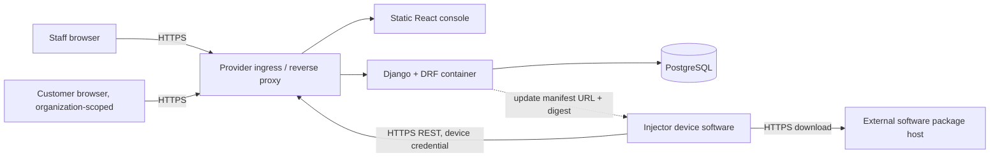

# Technical Specification: Pishgaman Shargh Injector Management Platform

**Status:** Engineering baseline for MVP implementation and deployment  
**Product scope:** [`product-spec.md`](./product-spec.md)  
**Interface system:** [`design-spec.md`](./design-spec.md)  
**Python tooling baseline:** [`python-boilerplate/uv-template`](https://github.com/python-boilerplate/uv-template)  
**Last reviewed:** 2026-11-18 (approved customer-access extension)

## 1. Purpose and scope

This document converts the confirmed product requirements into an implementable technical design. It covers the web console, API, database, device interface, containerization, deployment, security, operations, and engineering workflow. It is intended to guide implementation and provider deployment without changing the confirmed product scope.

The `python-boilerplate/uv-template` is used as a source of Python project-management and engineering practices: `uv` and a committed lockfile, Ruff, MyPy, Pytest, pre-commit, GitHub Actions, Docker patterns, development-container support, Makefile commands, and documentation conventions. It is not the application framework. The product backend remains Django and Django REST Framework with PostgreSQL. The dashboard remains a separate React/Vite application. The template's generic sample application, environment scheme, Docker Compose file, and project naming are to be adapted, not copied as product architecture.

The MVP is a modular monolith. It does not require a message broker, Kubernetes, microservices, or a separate cache until measured load or provider constraints justify them.

## 2. Architecture decisions

| Concern | Decision |
|---|---|
| Backend | Python 3.12, Django 5.2 LTS line, Django REST Framework |
| Database | PostgreSQL 17; production database may be provider-managed or a separately operated container |
| Python package management | `uv`, `pyproject.toml`, committed `uv.lock`; backend dependencies declared in one authoritative place |
| Web client | React, TypeScript, Vite static build; Persian RTL initial locale |
| API | Versioned JSON REST API at `/api/v1/` |
| Authentication | Staff/customer browser credentials and revocable secure sessions; unique revocable per-device credentials |
| Deployment unit | OCI-compatible Docker images; production image runs a production WSGI server, never Django `runserver` |
| Edge/TLS | Hosting provider ingress/reverse proxy terminates TLS and forwards trusted proxy headers |
| Static frontend | Served as static files by a web server/CDN or the provider's static hosting; may be co-hosted by a small web container if the provider requires one origin |
| State | PostgreSQL is durable source of truth; containers are replaceable and do not own persistent application state |
| Background jobs | Synchronous MVP API and scheduled database maintenance only; introduce a queue when concrete asynchronous work requires it |

Python dependency declarations must pin compatible ranges and lock exact resolved versions. Django and DRF upgrades are deliberate changes reviewed for compatibility. The current `requirements.txt` is to be migrated to `pyproject.toml` and `uv.lock` without changing runtime behavior; no dual source of truth is allowed after migration.

## 3. System context and components



### 3.1 Web console

The console is built as static assets. It calls the API over HTTPS and never connects directly to PostgreSQL. Production builds must not contain credentials or secrets. API origin and public runtime configuration must be injectable without rebuilding if the host serves a runtime config file; otherwise they are compile-time non-secret values. CORS is restricted to the production console origin when frontend and API use different origins. If they are served from one origin, same-origin deployment is preferred and CORS can remain disabled.

### 3.2 API service

The Django service owns staff, customer and device authentication, authorization, customer/device administration, check-ins, immutable event ingestion, fault summaries, release metadata and update assignments, and audit records. The service is stateless between requests apart from the database. All durable state resides in PostgreSQL. Do not store package binaries or user-uploaded files in the application container.

Organize Django code by product domain (users/access, customers/devices, events/faults, releases/assignments, audit) while preserving Django's standard app boundaries. HTTP views should validate input and delegate non-trivial domain transitions to explicit service functions. Database constraints enforce unique serial numbers and per-device event IDs; transactions protect related state changes. API serializers define the public payload contract. Admin pages support controlled internal operations and must share the same authorization/audit rules.

### 3.3 PostgreSQL

PostgreSQL stores relational product data, credentials as one-way hashes/digests, timestamps in UTC, event history, assignments, and audit history. The database is not exposed publicly. The API connects using a dedicated least-privilege application account; schema migration uses the same account only where supported or a distinct deployment account with DDL rights. Production data is persisted on provider-managed durable storage or a durable database service, never only in a container layer.

### 3.4 External package host

Release records reference an HTTPS package URL and expected SHA-256. The device downloads directly from that host. The management API does not proxy package bytes. A digest protects against accidental or in-transit corruption only when the manifest is trusted; production release authenticity also requires signed metadata or an equivalent public-key verification design supported by the device updater.

## 4. Repository and project layout

Retain the current repository's clear separation of frontend and backend. The implementation should converge on a structure equivalent to:

```text
backend/
  pyproject.toml
  uv.lock
  manage.py
  config/
  devices/                  # existing domain app; split further when useful
  tests/
  Dockerfile
  .dockerignore
frontend (existing root Vite app)/
  package.json
  package-lock.json         # commit the chosen npm lockfile
  src/
compose.yaml                # local development only
compose.production.yaml     # optional single-host deployment overlay
.env.example                # documented local variables; no secrets
.github/workflows/          # CI and prototype deployment kept separate
Makefile                    # stable developer command interface
technical-spec.md
```

The exact directory move is not required to achieve the architecture. Avoid duplicating the backend definition in root and backend compose files. Keep the existing prototype Pages deployment isolated from production API release/deployment workflows. Use the boilerplate's Makefile and docs ideas, but define commands for this repository and support Windows PowerShell as well as Unix shells where feasible.

## 5. API contract

### 5.1 Common rules

- Prefix all product endpoints with `/api/v1/`; changes that break existing device clients require a new API version or an explicit backward-compatible transition.
- Use JSON with UTF-8. Document request/response schemas, authentication, status codes, limits, and examples in a maintained OpenAPI document or equivalent generated schema.
- Use ISO-8601 timestamps with timezone offsets in requests and UTC in storage. Responses use UTC timestamps; presentation applies the user's locale/timezone.
- Return stable machine-readable error codes and field-level validation details. Never return stack traces or internal secrets.
- Paginate all potentially unbounded collections. Establish a maximum page size and maximum request-body size at both proxy and application layers.
- Enforce rate limits at the edge and application layer. Provide explicit limits for staff/customer login, device check-in, event batch ingestion, and manifest polling.
- Health endpoints: `/health/live` indicates process health without database dependency; `/health/ready` checks required dependencies and is used by provider health checks. Neither reveals configuration or sensitive exception details.

### 5.2 MVP endpoint families

The current endpoint family is the baseline: staff login/logout, dashboard summary, customer/device/event/release resources, device check-in, event batch ingestion, update manifest, and update result. Preserve or document these resource URLs before connecting production device clients. Administrative routes require staff permissions; device routes require a device credential and must reject staff credentials unless explicitly intended.

### 5.3 Device authentication and ingestion

- A device credential identifies exactly one device and can be revoked/rotated without changing its serial number. Provisioning secrets are displayed once, never stored plaintext, and never logged.
- Use constant-time credential comparison where applicable. Apply TLS, per-device throttling, payload and field limits, and replay/idempotency rules.
- Each event has a stable event UUID scoped by device, original `occurred_at`, code/type, reported state, optional stable `fault_id`, software version, summary/translation key, and bounded structured metadata. Server receipt time is assigned by the server.
- The unique constraint `(device_id, event_id)` guarantees idempotency. A repeated ID with identical immutable payload returns `duplicate`; conflicting reuse returns `rejected` and creates a security/operations diagnostic without overwriting the original.
- Each batch returns a per-event outcome. The device removes an event from its durable queue only after `accepted` or `duplicate` acknowledgement. Batches are bounded (current implementation target: up to 200 events, subject to measured body size).
- Delayed or out-of-order events remain in history. Current fault state is derived from the latest event by occurrence time, with deterministic tie-breaking; older arrivals cannot replace newer fault state. Check-in last-seen time uses server receipt time and cannot move backwards due to event timestamps.
- Validate timestamp range, UUID syntax, code allowlist/format, metadata depth/size, allowed state values, and event count. Preserve unknown future fields only if the versioning policy explicitly permits it.

### 5.4 Browser identity and authorization

- No public registration. Super administrators provision/disable staff and customer accounts and assign authorized roles and customer organization membership. Customer users never receive staff flags merely to permit sign-in.
- Enforce roles on the server for every query and mutation. Support users can inspect operational records; super administrators manage accounts, customers, devices, releases, rollout targets, and other privileged settings according to the product spec.
- Staff session/token expiry, rotation, and revocation are required. Prefer secure, HttpOnly, SameSite cookies and CSRF protection for a same-origin browser application. If bearer tokens are retained, define expiry, secure client storage, logout revocation, and XSS risk controls; long-lived browser tokens in local storage are prohibited for production.
- Superuser status must not become a broad bypass in application APIs. Test every role boundary.
- The approved MVP includes a limited customer device panel. Its contract, organization isolation and migration requirements are specified in section 5.6; extended customer self-service remains deferred.

### 5.5 Update API

- A release manifest includes immutable release identity/version, HTTPS package URL, digest, compatibility criteria, signed metadata reference/signature, and release notes.
- Publish action records actor, time, target, compatibility, and immutable release data. A newly created release follows the confirmed automatic publication policy.
- Devices report a safe/idle state, but device-side code retains final authority to install only at a safe point. Server responses are advice/metadata and never constitute real-time control.
- Device results are idempotent where practical and include lifecycle state, client timestamp, server receipt time, and sanitized result code. Reject impossible state transitions or retain raw reports separately from derived rollout state.
- Rollback is an audited assignment of a retained older release. It does not overwrite release history and does not force installation during a running test.
- Do not enable production remote update rollout until the device updater's signature verification has been reviewed and signed-manifest validation is implemented end to end.

### 5.6 Approved customer-access contract (2026-11-18)

This contract is implemented by the CUST-001 through CUST-007 increment. Browser identity reuses the existing session/CSRF/throttling implementation and preserves staff permissions. See devices/access.py, devices/portal.py and the customer frontend components; Beads records verification and delivery status.

**Membership and migration:** Keep Django's existing user model and staff role mapping. Add CustomerMembership with a unique user relation and a protected Customer foreign key; this is the customer role marker. A customer account has exactly one organization; organizations may have multiple accounts. Do not automatically infer membership from contact email or serial numbers, convert staff, replace AUTH_USER_MODEL or rewrite applied migrations. Use additive PostgreSQL migrations and test both a fresh database and upgrade preserving existing users/devices/audits. Validate against existing data before any database operation; no database reset is authorized. Deny mixed staff/customer identities and missing membership on every protected request, including admin paths if native editing is exposed.

**Browser session:** Extend existing /api/v1/auth/login/, /session/ and /logout/ contracts backward-compatibly. Return explicit role customer and safe organization identity (ID/name) for eligible customers while preserving staff responses. Reuse CSRF, cookie flags, session rotation, configurable expiry (initially the existing browser session-age setting), generic errors and the PostgreSQL-backed login limiter; do not create unthrottled alternate login. Re-evaluate active account, role, current membership and non-archived organization for every request. Logout revokes the server session; account deactivation, password change or membership removal denies subsequent access. Audit authentication and provisioning outcomes without passwords/hashes/tokens. Do not store credentials or identity authority in localStorage.

**Customer API surface:**

| Endpoint | Caller | Contract |
|---|---|---|
| /api/v1/customer-users/ GET, POST | Super administrator | List/provision customer accounts with validated email/password and explicit active organization; no staff privilege fields |
| /api/v1/customer-users/{id}/ PATCH | Super administrator | Controlled account activation/deactivation; no arbitrary roles/groups or cross-organization reassignment |
| /api/v1/customer/devices/ GET | Eligible customer | Paginated current-organization active devices; serial/model search and online/offline filter |
| /api/v1/customer/devices/{id}/ GET | Eligible customer | Lookup within that same scoped queryset; consistent 404 for absent or foreign IDs |
| /api/v1/customer/summary/ GET | Eligible customer | Own-organization device/online/offline counts, generated_at and online_window_minutes only |

These namespaces are separate from the retained staff URLs and IsStaffUser/IsSuperAdministrator checks; customer sessions cannot access staff data or mutations, Django admin, audit/event/release resources or device credential APIs. Reject unsupported methods and caller-supplied organization scopes. Staff account creation continues through its existing endpoint; it must not become a customer privilege bypass.

**Query and response boundaries:** Resolve organization exclusively from current authenticated membership. Apply ownership before detail lookups, search, filters, pagination counts and aggregation. Allowlist device fields: id, serial_number, model_name, software_version, location, last_seen_at and derived estimated online status. Exclude internal contact fields/notes, credentials/digests, raw payloads, events/faults, releases, assignments and audits. Never expose global totals to customers. Mark authenticated data private/no-store and never cache solely by URL across users; stale frontend responses must not repopulate a cleared or changed session.

**Lifecycle and connectivity:** Archived organizations deny customer portal access; do not change existing device-ingestion or credential behavior merely because a Customer is archived. Exclude archived devices from the customer panel. Reassignment changes visibility on subsequent requests, based on the current Device.customer foreign key; do not rely on copied memberships/device lists. Use the existing configurable 15-minute online calculation, test its exact boundary and last_seen_at=null, expose freshness and never-connected state. Connectivity is an estimate; there is no remote connect/control endpoint.

**Account administration:** Customer-user provisioning, membership creation and audit must commit atomically. Use existing password validation and normalized case-insensitive email checks across browser roles; reject ambiguous existing records rather than silently selecting a user or merging data. Validate active organizations. Only super administrators may list/provision/deactivate customer accounts; support and customer privilege-field injection is rejected. No public registration, invitation sender, automatic password delivery or customer self-management is added.

## 6. Data and persistence requirements

Core tables are User, CustomerMembership (approved addition), Customer, Device, DeviceCredential, DeviceEvent, DeviceFault/current projection, SoftwareRelease, UpdateAssignment, and AuditEntry. Add explicit indexes for serial number, customer/device relationship, event `(device_id, occurred_at)`, event code/state where queried, release compatibility/lookups, assignment state, and audit target/time. Verify indexes against actual query plans as data grows.

Use database foreign keys and constraints for invariants. Customer/device archiving is preferred to destructive deletion when records are referenced. Event rows are immutable after acceptance except for strictly operational metadata that cannot change event facts. Audit entries exclude secrets and should be append-only to application roles. Retention, legal deletion, and export policy must be agreed before production data is accumulated.

Schema changes use committed Django migrations. Production migration is a deliberate release step with backup/rollback planning; application startup must not run `migrate` concurrently in every replica. A migration failure must fail deployment clearly without silently serving an incompatible schema.

## 7. Docker and deployment requirements

### 7.1 Images

- Build a multi-stage or otherwise minimized production API image from a maintained Python 3.12 slim base. Install locked runtime dependencies only. Do not include compilers, tests, Git, development secrets, `.env` files, or local databases in the final image.
- Run as a non-root user, use a predictable working directory, set `PYTHONDONTWRITEBYTECODE=1` and `PYTHONUNBUFFERED=1`, and expose only the application port internally.
- Start Django with Gunicorn (or a provider-approved production WSGI server) and a documented worker/concurrency configuration based on CPU/memory limits. Do not use `manage.py runserver` in production.
- Build frontend static assets in a Node build stage and serve them using provider static hosting/CDN or a minimal static web image. Do not put Node tooling in the API runtime image.
- Tag images immutably by commit/release and record image digest. Support rolling back to a prior known-good image.
- Add `.dockerignore` to exclude virtual environments, node_modules, Git history, local databases, secrets, build artifacts, and caches.

### 7.2 Local Docker Compose

`compose.yaml` is a development convenience, not a production high-availability design. It should provide the API, PostgreSQL, and optionally a frontend dev server; use an isolated private network, named database volume, health checks, restart behavior appropriate for local work, and explicit development-only credentials. Bind-mount source only for development. The API should wait for PostgreSQL readiness, but database startup dependencies do not replace application retry handling.

The local command should perform migrations explicitly and start the production-like application command where practical. Development may use Django `runserver` only behind a clearly named development profile. Never expose PostgreSQL to the public internet.

### 7.3 Production topology

Preferred provider topology: public HTTPS ingress/load balancer; static frontend hosting; one or more API containers on a private service network; managed PostgreSQL with private connectivity and automated backups. If the provider offers only a single Docker host, run API and PostgreSQL as separate containers with private networking and a durable database volume, and place TLS/reverse proxy at the provider or a separately maintained proxy container. The database volume must be included in backup and restore procedures.

Container orchestration, service names, health-check syntax, secrets delivery, disk mounts, and deployment commands are provider-specific. Do not assume Compose is accepted as a production deployment format. The image remains portable OCI; a provider-specific deployment manifest may be added after the provider is selected.

### 7.4 Configuration and secrets

Configuration is provided through environment variables or provider secret injection. `.env.example` documents names and safe local defaults only; `.env` is ignored by Git. Production secrets never enter the image, build arguments, logs, repository, or CI artifacts. Require a high-entropy `DJANGO_SECRET_KEY`, strong database credentials, restricted `ALLOWED_HOSTS`, exact CORS origins, secure cookie settings, and trusted proxy configuration. Fail startup in production if required values are missing or unsafe; DEBUG must be false.

Document variables including Django secret/debug/hosts, database host/port/name/user/password, public console origin, CSRF trusted origins, secure proxy/TLS settings, online threshold, logging level, and connection timeout/pool settings. Do not accept arbitrary production defaults that permit wildcard hosts or origins.

### 7.5 Startup and release sequence

1. Build, scan, and publish immutable API and frontend images/artifacts from a reviewed commit.
2. Back up the database before destructive or high-risk schema changes.
3. Run migrations once as a release job using deployment credentials.
4. Deploy API and frontend versions; wait for readiness checks.
5. Verify public TLS, health, staff and customer login/isolation, database access, and a device API smoke path using non-production credentials/data.
6. Monitor errors and latency; roll back application images if needed. Database rollback uses forward-fix or a rehearsed restoration plan, not blind reverse migrations.

## 8. Security requirements

- HTTPS/TLS is mandatory for staff/customer browser APIs, device APIs, and package downloads. Configure secure proxy headers only for known trusted ingress; do not trust client-supplied forwarded headers.
- Restrict administrative access, enforce least privilege, rate-limit authentication and device endpoints, and audit security-sensitive operations.
- Store staff and customer passwords with Django's supported adaptive password hashers. Device credentials are random, high entropy, hashed at rest, shown once, rotatable, and revocable.
- Use CSRF protection for cookie-authenticated state changes, secure/HttpOnly/SameSite cookies, clickjacking and content-type protections, and an appropriate Content Security Policy at the edge/web server.
- Validate all user/device input, cap request size and metadata nesting, prevent mass assignment, use ORM parameterization, and encode rendered content.
- Prevent credential/token leakage in logs, error monitoring, audit records, traces, URLs, and analytics. Sanitize update result details.
- Keep dependencies current through reviewed lockfile updates. CI should scan dependencies and container images where the hosting/tooling supports it; security reports must be actionable and secrets must be protected.
- Ensure CORS allows only required origins and methods/headers. CORS is not authentication.
- Define staff account recovery and emergency access procedures before production.
- Remote update signing and key rotation must be designed with the device updater before enabling production rollout.

## 9. Reliability, observability, and operations

### 9.1 Health and resilience

The process must restart cleanly and tolerate transient database connectivity loss with bounded retries. Liveness checks must not create dependency storms; readiness checks fail when the API cannot serve requests safely. Device retries use bounded exponential backoff with jitter and durable local queues. API duplicate handling allows safe at-least-once delivery.

### 9.2 Logging and monitoring

Emit structured application logs to stdout/stderr for provider collection. Include timestamp, severity, request/correlation ID, route template, response status, duration, actor/device identifier where permitted, and event/result counts. Exclude credentials, tokens, passwords, full sensitive payloads, and package URLs if they contain signed query parameters. Use UTC timestamps and log rotation/retention via the provider.

Monitor API availability, 4xx/5xx rate, request latency, database connection saturation, ingestion acceptance/rejection, duplicate/conflict rate, check-in freshness, update outcome rates, disk and database capacity, backup freshness, and migration/deployment failures. Alert thresholds are configured after expected fleet volume and provider service objectives are defined.

### 9.3 Backups and recovery

Production PostgreSQL must have automated encrypted backups and point-in-time recovery where available. Backups must be isolated from application credentials and tested through scheduled restoration exercises. Record recovery point objective (RPO), recovery time objective (RTO), backup retention, and restore owner before production launch. Container images and static assets are rebuildable; database state is not.

### 9.4 Capacity and service targets

Fleet size, event rate, payload size, retention, uptime, and response-time targets are not yet specified. Before launch, load-test expected and peak check-ins/batches, set request limits and database capacity, define storage growth and retention, and agree measurable service objectives. Do not claim availability or latency guarantees until the selected provider and deployment topology support them.

## 10. Engineering workflow from the boilerplate

Adopt the useful workflow assets from `uv-template`, adapted to the backend:

- `uv` manages dependencies and virtual environments; commit `uv.lock` and use locked/sync mode in CI and image builds.
- Ruff supplies linting, import ordering, and formatting. Configure rules appropriate for an existing Django codebase and resolve violations incrementally rather than enabling noisy checks without ownership.
- MyPy is introduced with Django-aware stubs/configuration where useful; strict checking is enabled progressively by module. Do not claim full type safety while third-party/Django boundaries are ignored.
- Pytest is the test runner. Tests are required engineering work for authentication, permissions, ingestion idempotency, out-of-order events, update targeting, migrations, and health behavior. CI executes them against PostgreSQL, not SQLite-only assumptions.
- Pre-commit runs fast formatting/lint checks. CI remains authoritative; hooks are not a security boundary.
- GitHub Actions should run backend lint/type checks, tests, dependency checks, and frontend build on relevant changes. A separate protected release workflow builds/publishes images and deploys only from approved branches/tags with scoped credentials.
- Makefile (or equivalent cross-platform task runner) provides documented `init`, `lint`, `format`, `typecheck`, `test`, `build`, `up`, `down`, `migrate`, and `deploy` tasks. Commands must reflect actual repo structure.
- Dev containers and MkDocs are optional DX assets. Add them if they improve onboarding and are maintained; they are not runtime dependencies.
- Commitizen/conventional commits and changelog automation are optional team process choices, not product requirements.

The template currently targets Python 3.10+ and includes general-purpose example tooling. The product should explicitly target Python 3.12 to align with the existing container and Django dependency support, then validate every runtime and CI image against that choice. Template versions and dependencies must be reviewed and locked rather than copied as floating `latest` values.

## 11. CI/CD and release controls

Pull request CI should: install the locked toolchain; run formatting/lint checks; run type checks; run unit/API/integration tests with PostgreSQL; build the production API image; build the frontend; and produce dependency/image scan results. CI must not use production secrets. Release workflows require protected environment approval if supported, least-privilege registry/deployment credentials, immutable tags, provenance linking artifact to commit, and a rollback reference.

The current GitHub Pages onboarding prototype workflow remains separate and limited to its prototype paths. It must not deploy the backend or expose production credentials. Production deployment automation is enabled only after the hosting provider is chosen and its secret, health-check, migration, and rollback capabilities are documented.

## 12. Testing and acceptance

Verification is part of the engineering definition of done. Minimum automated coverage includes:

- staff/customer login/logout, invalid or ambiguous credentials, inactive-user rejection, expiry, CSRF, throttling, session revocation and secret-free audit behavior;
- customer membership uniqueness, missing/mixed membership denial, administrator-only account provisioning/deactivation, organization archive, device reassignment, cross-tenant list/detail/search/filter/pagination/count isolation, safe field allowlists and staff/device endpoint denial;
- customer real-backend browser login, dedicated panel, direct routes, expiry/logout cleanup, stale-response protection, desktop/mobile RTL/themes and no demo fallback;
- customer/device CRUD rules, unique serial constraint, archive semantics, and credential rotation/revocation;
- check-in freshness, event schema validation, maximum batch/body sizes, accepted/duplicate/conflicting ID results, transaction behavior, and delayed/out-of-order fault projections;
- release compatibility, all-device and selected-device targeting, automatic publication, withdrawal, rollback assignment, safe/idle eligibility, and update-result lifecycle;
- health endpoints, production settings validation, API error shape, pagination, and migration from an empty supported database;
- Docker build and startup, non-root runtime, readiness behavior, and service recovery after database restart;
- frontend production build and API origin/configuration behavior.

Integration tests use PostgreSQL and realistic API authentication. Deployment smoke tests use a staging environment before production. A successful container build alone is not acceptance.

## 13. Non-functional requirements

- **Security:** No unauthenticated access to operational data; per-device identity; server-side authorization; TLS; audited privileged actions; no secret leakage.
- **Data correctness:** Immutable event facts; idempotent batch delivery; UTC storage; relational constraints; migration history.
- **Availability:** Provider and topology dependent; device autonomy and durable offline queues prevent a server outage from interrupting tests.
- **Performance:** Paginated queries and appropriate indexes; targets set after expected scale is supplied and load tests are run.
- **Accessibility/localization:** Follow `design-spec.md`; Persian RTL, keyboard access, visible focus, semantic status, reduced motion, locale-aware formatting.
- **Maintainability:** Versioned APIs, explicit domain boundaries, locked dependencies, reproducible container builds, documented operations.
- **Portability:** OCI images and environment-based config; provider-specific manifests isolated from application logic.

## 14. Implementation gaps to close before production

Repository inspection found the current backend is a Django/DRF scaffold with a development Dockerfile and a root Compose file. The API currently starts with `runserver`, and Compose runs `migrate --run-syncdb` at container startup. The Python backend uses `requirements.txt`; no backend test/CI or production deployment workflow was present in the inspected file list. Therefore the following are required implementation work, not features presumed to exist:

1. Replace production `runserver` with a production WSGI server and health/readiness configuration.
2. Add database migrations for all product models; remove `--run-syncdb` and make migration a one-time controlled release step.
3. Add production-grade image/build context, non-root user, `.dockerignore`, health checks, and local/production configuration separation.
4. Migrate dependencies to `pyproject.toml`/`uv.lock` and adapt quality tools to Django.
5. Add PostgreSQL-backed automated tests and CI gates.
6. Reconcile staff authentication with the product's secure browser-session requirements; current token behavior must not be assumed to meet production browser storage and revocation policy without review.
7. Review settings defaults, production secret validation, proxy/CSRF/CORS behavior, logging, and API payload/body/rate limits.
8. Implement and verify signed update metadata end-to-end with the device updater before rollout.
9. Select provider topology, managed-vs-container PostgreSQL, DNS/TLS, secret injection, backups, monitoring, RPO/RTO, capacity, retention, and deployment/rollback mechanism.
10. Wire the production dashboard to the API and ensure sample data is never presented as live fleet data.

## 15. Decisions required from hosting and operations

These are intentionally provider-specific or operational, not guessed by this document:

- Hosting provider/product and whether it runs Docker images, Compose, or another OCI deployment specification.
- Managed PostgreSQL availability, private networking, connection limits, backup/PITR options, and maintenance window.
- Public domains/origins for console, API, and package host; TLS ownership and proxy behavior.
- Expected device count, event volume and size, retention, and expected peak check-in/batch traffic.
- Required uptime, latency targets, RPO/RTO, backup retention, alert destination, and on-call owner.
- Package host and signing format/key custody/rotation compatible with the deployed updater.
- Whether the UI and API can share an origin, determining cookie/session and CORS details.

## 16. Definition of production readiness

The MVP is production-ready only when all of the following are true: product acceptance criteria in `product-spec.md` pass; automated PostgreSQL tests and CI checks pass; API and frontend production artifacts build reproducibly; production uses secure secrets and TLS; migrations have a rehearsed backup/restore and rollback/forward-fix procedure; provider health checks, logs, alerts, and backups are active; staff/customer account and device credential lifecycle is operational; device updater signature verification is verified before rollout; capacity and retention targets are agreed; and the production console uses live API data with clear freshness indicators.

## References

- Product decisions: [`product-spec.md`](./product-spec.md)
- Interface requirements: [`design-spec.md`](./design-spec.md)
- Python template organization: [python-boilerplate](https://github.com/python-boilerplate)
- UV project template: [python-boilerplate/uv-template](https://github.com/python-boilerplate/uv-template)
- Template project configuration: [`pyproject.toml`](https://github.com/python-boilerplate/uv-template/blob/main/pyproject.toml)
- Template workflow and features: [template README](https://github.com/python-boilerplate/uv-template)
